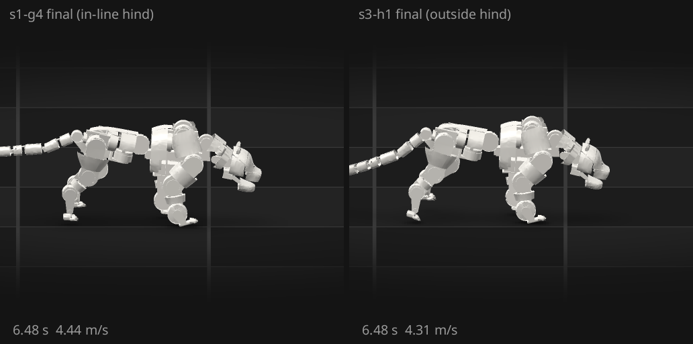
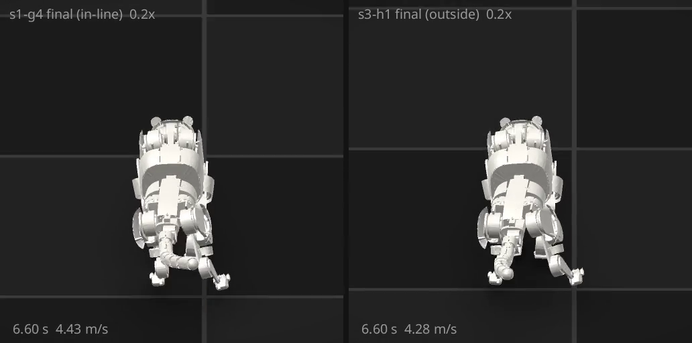

# orun10 S3: s3-h1 judged, the outside-hind stride measured

Verified against source: 2026-10-18. Frozen evidence (orun10, iteration 14).

## What was judged

s3-h1 is the S3 screen set up in `s3-outside-hind.md`. It started warm from
s1-g4's final policy (4.498 m/s), on the gallop task with one reward term
added: `outside_hind`, at weight 4, saturating at 60 mm (orun10-cat
`ccf3d180`). It ran at lr 3e-5 for 100 iterations, with a 10-iteration
critic warm-up and a checkpoint every 25. The trainer's reward per step
went from 13.05 at iteration 0 to 18.73 at iteration 99, and σ fell from
0.397 to 0.378.

Every checkpoint was judged: 25, 50, 75, the final and `gallop.best`
(it 99, a different file from the final with the same numbers). Each was
judged twice:

- on the trained bundle's own `gallop_spec`, seeds 1001–1010, through
  `~/orun10-progress/s3/judge_gallop.py`, which writes
  `orun10-cat/evaluations/s3-h1-<checkpoint>/evaluation.json`;
- with `~/orun10-progress/s10/hind_offset.py` on the same ten traces.

The script is `~/orun10-progress/s11/judge_h1.sh`. The baseline row is
s1-g4's final, measured the same way.

## Results (10 seeds each)

| checkpoint | pass | top 2 s speed, m/s (min / median / max) | hind outside the fore's print as it passes (median; p10, p90) | hind half-track − fore, every frame | hind touchdown outside the fore's last print | hind touchdown ahead of it | worst RMS / rated | peak ratio |
|---|---|---|---|---|---|---|---|---|
| s1-g4 final (baseline) | 0/10 | 4.466 / 4.486 / 4.498 | +8 mm (−11, +83) | −15 mm | −5 mm | +148 mm | 1.47–1.50 (j_elbow_l) | 1.000 |
| 25 | 0/10 | 4.372 / 4.395 / 4.411 | +25 mm (−10, +95) | −4 mm | −18 mm | +138 mm | 1.44–1.48 (j_elbow_l) | 1.000 |
| 50 | 0/10 | 4.231 / 4.235 / 4.249 | +46 mm (+17, +106) | +17 mm | +5 mm | +109 mm | 1.44–1.47 (j_elbow_l) | 1.000 |
| 75 | 0/10 | 4.230 / 4.241 / 4.254 | +53 mm (+29, +110) | +32 mm | +21 mm | +114 mm | 1.42–1.45 (j_elbow_l) | 1.000 |
| final (100) and best (99) | 0/10 | 4.299 / **4.310** / **4.325** | **+63 mm (+47, +101)** | **+41 mm** | **+33 mm** | **+119 mm** | 1.44–1.47 (j_elbow_l) | 1.000 |

On every checkpoint the failing predicate is `top_speed` alone. On the
final it has a median of 4310 mm/s against 5000. `completes` and `no_fall`
pass 10/10, there are no falls, every episode ends at the horizon, and
`flight_stride_share` is 1.00 with 60 ms of flight. The spine sits at 1.39–1.43
× rated. The model clamps the drives at peak, so the peak margin is 0 on
every checkpoint, as it is on s1-g4. The final's stride is 879 mm at
4.66 Hz, by the engine's fl-clock count, against s1-g4's 904 mm at 5.00 Hz.
The footfall order is unchanged: fl→fr, then fl→hl→hr. The median
`mean_lateral_speed_mm_s` rose from 152 to 186 mm/s.

## Reading

- **The cat takes the outside-hind stride when it is paid for it.** The hind
  passes the fore's print 63 mm outside it, against 8 mm. That is over half
  of the ~75 mm side travel that `j_hhaa` allows. Measured on every frame,
  the hind track now runs 41 mm wider than the fore's, against 15 mm
  narrower. The hind lands 33 mm outside the fore's print and 119 mm ahead
  of it, which is O6's shape.
- **It costs speed.** The best 2 s speed drops 0.18 m/s against s1-g4's
  final (4.310 against 4.486, −3.9 %). The drop is steepest by iteration 50
  (4.235 m/s); at the final it is partly recovered. The worst drive is the
  same (j_elbow_l, about 1.45 × rated, at peak), so the wider hind track buys
  no torque headroom that turns into speed.
- **For S3: it does not help on this body at this screen.** The stride is
  trained on purpose and measured, and it is slower than the in-line stride
  it came from. A longer run might recover the speed, but nothing in the
  curve shows it overtaking the in-line stride: the final is 0.18 m/s behind
  with the offset still rising.

## Filmed (orun10, iteration 15)

Two films of seed 1001 put s1-g4's final (in-line hind) and s3-h1's final
(outside hind) side by side. Each is drawn from the evaluation's own trace,
with the evaluation film's stage (`cli/cadex_cli/film.py`): the accepted
attempt's tessellation on the dark mat. The window follows the chest at a
fixed size. The script is `~/orun10-progress/s12/film_side.py`. The films
live outside the repo, beside it, and go on the run's page.

- `s3-vs-s1-side.mp4` (20.1 s): side-on to +x at 12°. The whole 10 s
  episode plays in real time at 25 fps, then 6.0–8.0 s plays at 0.2×.
  Still: `s3-film-side.png`.
- `s3-vs-s1-rear.mp4` (10.1 s): from behind at 35°, 6.0–8.0 s at 0.2×.
  It shows the lateral offset the side view cannot. Still:
  `s3-film-rear.png`, which shows s3-h1's hind feet set wider than
  s1-g4's.

The speed overlay is the chest's +x speed over the trailing 0.5 s. Seed
1001's best 2 s window is 4.466 m/s for s1-g4 and 4.302 m/s for s3-h1, as
`top_speed` records.

