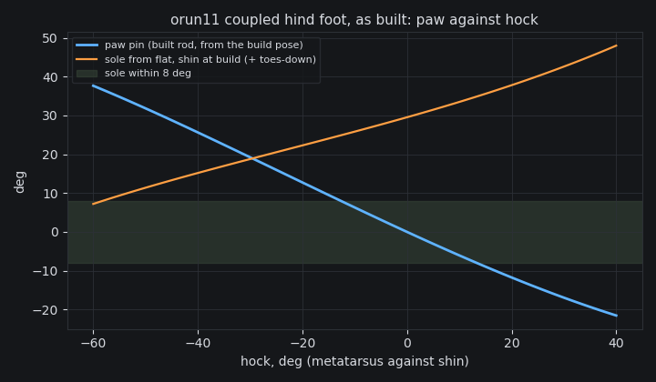

# orun11 M1: three coupled hind-foot linkages, and the pick

Verified against source: 2026-10-18.

A planar study, on CPU, of three ways to tie the hind paw's angle to the
hock's on `~/cadex-projects/orun11-cat` (cat15, the cat14 hind leg). Nothing
is built here; the chosen ratio goes to a screen on the scratch copy
`orun11-cat-eq`, held by an `equality/joint` coupling (see the end).

```
pixi run python docs/probes/orun11/foot_linkage.py --png docs/probes/orun11/foot-linkage.png
```


## What the foot has to do

Angles are about +y, positive toes-down (the left leg's hinges). `hock` is
the metatarsus against the shin, `pin` the paw against the metatarsus, both
from the build pose (paw seated −36°). The sole is flat when
`shin + hock + pin = 36`.

- **Plantigrade, at the hock's −60° stop:** the metatarsus level. The hock
  axis is then 40 mm over the floor (the pin's height over the sole), so the
  AK60's case (r 39.5) touches it. The paw is flat at pin +96°, the
  charter's figure.
- **On the toes at toe-off,** hock 0 to +20°: the sole 15–45° toes-down of
  flat.

The line `pin = 60 − 0.6·hock` meets both. With the shin at its build pitch,
it keeps the sole within 8° of flat from hock −60° to −40°. It puts the
sole 24° on its toes at hock 0 and 36° at +20.

For comparison, t2-g5 at iteration 200 (free pin, 10 seeds, stance after
1 s) had a median left stance of hock −16° and pin +82°, with the shin
pitched −24°. At toe-off the left was at hock −11° and pin +59°, with the
sole flat. The right leg stood with its metatarsus 41° past the build
pose and never laid the hock down.

## The three candidates

| | coupling | rms off the line | sole ≤ 8° of flat | transmission | link force, 3× BW on the toes |
|---|---|---|---|---|---|
| **A: rod from the shank**, inboard of the shin plate | four-bar: rod end 20.5 mm from the hock axis, paw horn 32 mm from the pin, rod 92.3 mm | **0.5°** (worst 1.4) | hock −60..−42 | 60–90° | **998 N** (compression), lever 27.7–32 mm |
| B: four-bar off the hock housing, in the case's plane | rod end on the housing rim (r 44), horn 32 mm | 37.8° (worst 93) | −60..−23, then off the line | 56–90° | 1041 N |
| C: tendon, sector on the housing rim | r_h 44 / r_p 28 = 1.57, linear | 56° | −60..−46 | — | 988 N |
| C′: tendon, sector inboard of the shin plate | r_h 15 / r_p 25 = 0.60, linear | 0 | −60..−40 | — | 1106 N, tension only |

The load case is 3× body weight (3 × 307 N, the t2-g5 model) on the toe
beans, 30 mm ahead of the pin, with the hock case just off the floor. That
is a pin moment of 27.7 N·m, held by the link.

**Why the housing-plane options fail (B, C).** In the drive case's plane,
any link keeps at least the case radius (about 42 mm) from the hock axis.
A four-bar's speed ratio is the coupler's distance from the hock axis over
its distance from the paw pin, and the paw allows at most 32 mm. So the
ratio there cannot fall below about 1.3, and 0.6 needs the link out of the
case's plane. The tendon has the same limit: its sector must clear the
case (r_h ≥ 44 mm) and the paw is 46 mm long (r_p ≤ 28 mm).

**The pick: A, a rod from the shank, inboard of the shin plate.**

- It holds the line within 1.4° over the hock's whole −60..+40° travel.
- Its transmission angle stays ≥ 60°.
- It works in both directions. It holds the paw against a toe load and
  against heel-strike, which lands behind the pin, with no pretension and
  no return spring.
- A turnbuckle in the rod sets the seat, so the flat band can be moved
  along the hock range.

The tendon C′ is as straight a line, but it only pulls. A heel-strike on
the pad slackens it, so it needs a return spring and about 1.1 kN of
pretension that the cable must hold without creep. C′ is kept as the
fallback.

**What A is, as a part (for M1's build):**

- **Upper rod end:** a lug on the inboard face of the shin plate, 20.5 mm
  from the hock axis. In the build pose it is at (−248.3, 150.1), behind
  and above the axis. The rod runs in a plane inboard of the shin plate,
  so it never meets the drive case or the metatarsus plate. (This study
  put the plate at y 63–71, which is the AK70 knee's. The cat has the
  AK10-9 knee, so the plate is at y 51.5–59.5. As built, the rod's plane
  is at y 37.5; see below.)
- **Lower rod end:** a horn on the paw's inboard side, 32 mm from the
  pin. In the build pose it is at (−227.7, 83.5), reaching from the pad's
  inboard wall (y 80) in to the rod's plane.
- **Rod:** 92.3 mm between centres, in compression under a toe load. An
  M5 threaded rod has a root diameter of 4.1 mm. Its Euler load over
  92 mm in steel is 3.2 kN, 3.2× the 998 N case.
- **Rod ends:** M5 steel spherical rod ends, which take the few degrees of
  misalignment the out-of-plane rod needs.
- **Pins:** M5 shoulder bolts in flanged bushings. At 998 N, double shear
  on the 5 mm pin is 25 MPa.

The fit and sweep checks, the link loads in the built geometry and the
static check are M1's build, not this study's (below).

## What the study does not settle

- **The flat band is in hock terms, with the shin at its build pitch.**
  At the left gallop's median shin pitch (−24°), plantigrade would need
  hock −36° and pin 82°, which this coupling puts 14° toes-up. So the
  plantigrade reference (rung 6) has to bring the shin within about ±8°
  of its build pitch at push-off, with the hock at its −60° stop. The
  alternative is to move the band with the rod's length.
- **The gait generator ignores couplings.** `CadexGait.generate` solves
  the paw pin as a free chain joint, so a clip's pin can disagree with the
  rod. The pin moves the foot point only a few millimetres, but rung 6
  should make the generator hold couplings (an ADR).

## The screen: orun11-cat-eq

The scratch copy `~/cadex-projects/orun11-cat-eq` (script
`orun11-cat-eq1.py`) changes three things in the hind legs:

- the paw is re-seated 60° toes-down, so the build pose lies on the line;
- the pin's backstops are 2° past the coupled range (left −26..+38°,
  right mirrored);
- `assembly.coupling([(pawpin, 1), (hock, 0.6)])` holds each paw.

The coupling is an `equality/joint` row with no physical part. **It is a
screen of the ratio, not the design** (O2). Everything else, including the
task, the clip and the 17 terms, is orun11-cat's.

## As built: orun11-cat revision 4cd04aaf (script `orun11-cat16`)

```
pixi run python docs/probes/orun11/foot_static.py <cat_model-model.xml> [--side l|r] [--png foot-built.png]
```



Rod A, as parts, in each hind leg (`COUPLED_FOOT` in the script):

- **The lug** is a 6 mm 6061 strap at y 41–47. The AK60's 57 mm rear boss
  stands through the shin plate to y 47.5, inside the rod end's
  20.5 mm radius. So the strap spans the boss's rear face 0.5 mm off it.
  It runs from the rod end's bushing boss up the shin to a foot bolted to
  solid plate 40 mm from the hock axis. The first two builds put a lug
  there: one floated in the drive's opening, the next cut 581 mm³ into
  the drive.
- **The rod** is two M5 steel spherical rod ends (eye 18 mm, housing 6 mm,
  at y 34.5–40.5), M5 LH/RH studs and a 20 mm turnbuckle, 95.67 mm
  between centres, one steel component.
- **The horn** is a 5.5 mm 6061 plate beside the rod end, from the eye
  (32 mm from the paw pin) down to a 9 mm standoff. The standoff runs out
  through the pad's inboard wall.
- **Each pin** is an M5 shoulder bolt in a flanged bronze bushing (5 × 7
  mm), with 0.5 mm between each rod end and its flange. The paw pin keeps
  its M4 bolt and bushings, and loses its stops: the rod sets it.
- **The paw is re-seated** on the curve at the build pose (hock 0: pin
  +65.5 of the old seat, so `PAW_SEAT` = +29.55).
- **The loop:** shin, metatarsus, paw and rod form a planar four-pin
  four-bar (ADR-595). The model closes it at the rod's lower pin with an
  `equality/connect`. The export check misread that connect beside the
  cat's touch sites, which ADR-775 fixes.

**The turnbuckle seat** is 95.67 mm, against the study's 92.29. It moves
the plantigrade band toward the shin pitch the gallop stands at. With
the metatarsus level, the sole is 7.2° toes-down at the build pitch and
7.4° toes-up at −24° (t2-g5's left median). At 92.29 those were 0 and
−13.7.

**Verdicts** on 4cd04aaf:

- fit **pass**: 7,626 pairs, none failing;
- sweep **pass**: 36 of 36 limited joints swept, no failing pair, the
  hock's whole −60..+40° with the loop re-closed at every sample;
- panels: 0 failing of 45, the same 12 advisory `egg` rows as before;
- mounting **pass**: 30 of 30 purchased parts held.

The 31 welds reported "not touching" are the design's existing gaps (the
drives seat 0.5 mm off their housings, as in earlier revisions).

**The coupling curve** is the left leg, from the exported model, with
the loop closed by least squares (residual 0.0000 mm). The right is the
mirror, with the same numbers.

| hock | −60 | −40 | −20 | 0 | +20 | +40 |
|---|---|---|---|---|---|---|
| paw pin, from the build pose | +37.7 | +25.6 | +12.7 | 0.0 | −11.7 | −21.5 |
| sole from flat, shin at build (+ toes-down) | +7.2 | +15.2 | +22.3 | +29.6 | +37.8 | +48.0 |
| rod lever about the pin, mm | 25.9 | 29.4 | 31.4 | 32.0 | 31.3 | 30.1 |

The least-squares line is pin = +0.8 − 0.611 · hock (rms 0.65°), the
study's slope.

**The static check (M1).** The trunk is level and the floor is under the
paw. At each shin pitch the hock lays down, to its −60° stop at most,
until the case's 40 mm collision sphere meets the floor:

| shin pitch | 0 | −2 | −6 | −10 | −14 | −18 | −20 | −22 | −24 |
|---|---|---|---|---|---|---|---|---|---|
| hock | −60 (stop) | −60 (stop) | −60 | −55.8 | −52.3 | −48.8 | −47.0 | −45.3 | −43.3 |
| sole from the floor | +7.2 | +5.2 | +1.2 | −0.9 | −3.5 | −6.1 | −7.4 | −8.8 | −10.0 |
| case over the floor, mm | 11.1 | 7.4 | 0 | 0 | 0 | 0 | 0 | 0 | 0 |
| sole ≤ 8°, case ≤ 10 mm | fail | pass | pass | pass | pass | pass | pass | fail | fail |

So the foot meets M1's pose, sole flat and case down, **for a push-off
shin pitch of −2° to −20°**. M1 asks for the check in the gait
reference's stance pose, and that reference is rung 6, not yet written.
The plantigrade clip must put the hind push-off in this band, about −11°
being the middle. A shin at its build pitch leaves the case 11 mm up
against the hock's stop. A shin past −20° tips the sole toes-up, and the
turnbuckle moves the band about 2.1° per mm of rod (3.38 mm moved it 7.2°).

**The link loads at a 3× body-weight push** (3 × 309 N, the built
model's 31.5 kg). The load is on the toes, at the toe sphere's lowest
point or 30 mm ahead of the pin, whichever is further, so the pin moment
is 27.8 N·m:

| hock | −60 | −40 | −20 | 0 | +20 | +40 |
|---|---|---|---|---|---|---|
| rod force, N (compression) | 1073 | 947 | 884 | 869 | 888 | 923 |
| M5 pin, double shear, MPa | 27.3 | 24.1 | 22.5 | 22.1 | 22.6 | 23.5 |
| rod Euler margin (4.13 mm root, 95.7 mm, steel) | 2.9× | 3.3× | 3.5× | 3.6× | 3.5× | 3.4× |

The worst is at the plantigrade stop, where the rod's lever is shortest
(25.9 mm): 1.07 kN, 2.9× under the rod's buckling load. The rod ends
bought must be rated above 1.1 kN static, with margin for impact (not yet
measured).

**What this does not settle.**

- The plantigrade clip, and whether its push-off lands in the band.
- The closure in training. The connect is soft, with a two-step time
  constant (ADR-593's measured opening grows with step² and speed²).
  `rod1-s1` is the first run on it, cold, on eq1-s1's task and clip.
- `CadexGait.generate` still solves the paw pin as a free joint (rung 6).

