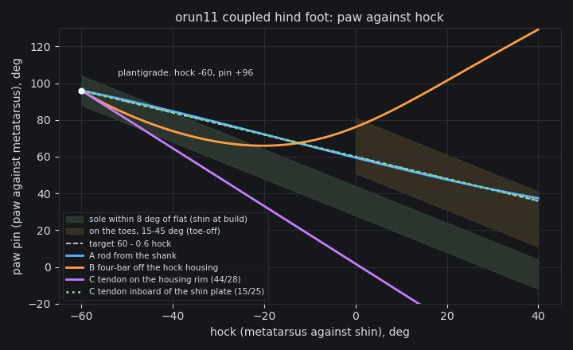

# orun11 M1: three coupled hind-foot linkages, and the pick

Verified against source: 2026-10-18.

A planar study, on CPU, of three ways to tie the hind paw's angle to the
hock's on `~/cadex-projects/orun11-cat` (cat15, the cat14 hind leg). Nothing
is built here; the chosen ratio goes to a screen on the scratch copy
`orun11-cat-eq`, held by an `equality/joint` coupling (see the end).

```
pixi run python docs/probes/orun11/foot_linkage.py --png docs/probes/orun11/foot-linkage.png
```



## What the foot has to do

Angles are about +y, positive toes-down (the left leg's hinges). `hock` is
the metatarsus against the shin, `pin` the paw against the metatarsus, both
from the build pose (paw seated −36°). The sole is flat when
`shin + hock + pin = 36`.

- **Plantigrade, at the hock's −60° stop:** the metatarsus level. The hock
  axis is then 40 mm over the floor (the pin's height over the sole), so the
  AK60's case (r 39.5) touches it. The paw is flat at pin +96°, the
  charter's figure.
- **On the toes at toe-off,** hock 0 to +20°: the sole 15–45° toes-down of
  flat.

The line `pin = 60 − 0.6·hock` meets both. With the shin at its build pitch,
it keeps the sole within 8° of flat from hock −60° to −40°. It puts the
sole 24° on its toes at hock 0 and 36° at +20.

For comparison, t2-g5 at iteration 200 (free pin, 10 seeds, stance after
1 s) had a median left stance of hock −16° and pin +82°, with the shin
pitched −24°. At toe-off the left was at hock −11° and pin +59°, with the
sole flat. The right leg stood with its metatarsus 41° past the build
pose and never laid the hock down.

## The three candidates

| | coupling | rms off the line | sole ≤ 8° of flat | transmission | link force, 3× BW on the toes |
|---|---|---|---|---|---|
| **A: rod from the shank**, inboard of the shin plate | four-bar: rod end 20.5 mm from the hock axis, paw horn 32 mm from the pin, rod 92.3 mm | **0.5°** (worst 1.4) | hock −60..−42 | 60–90° | **998 N** (compression), lever 27.7–32 mm |
| B: four-bar off the hock housing, in the case's plane | rod end on the housing rim (r 44), horn 32 mm | 37.8° (worst 93) | −60..−23, then off the line | 56–90° | 1041 N |
| C: tendon, sector on the housing rim | r_h 44 / r_p 28 = 1.57, linear | 56° | −60..−46 | — | 988 N |
| C′: tendon, sector inboard of the shin plate | r_h 15 / r_p 25 = 0.60, linear | 0 | −60..−40 | — | 1106 N, tension only |

The load case is 3× body weight (3 × 307 N, the t2-g5 model) on the toe
beans, 30 mm ahead of the pin, with the hock case just off the floor. That
is a pin moment of 27.7 N·m, held by the link.

**Why the housing-plane options fail (B, C).** In the drive case's plane,
any link keeps at least the case radius (about 42 mm) from the hock axis.
A four-bar's speed ratio is the coupler's distance from the hock axis over
its distance from the paw pin, and the paw allows at most 32 mm. So the
ratio there cannot fall below about 1.3, and 0.6 needs the link out of the
case's plane. The tendon has the same limit: its sector must clear the
case (r_h ≥ 44 mm) and the paw is 46 mm long (r_p ≤ 28 mm).

**The pick: A, a rod from the shank, inboard of the shin plate.**

- It holds the line within 1.4° over the hock's whole −60..+40° travel.
- Its transmission angle stays ≥ 60°.
- It works in both directions. It holds the paw against a toe load and
  against heel-strike, which lands behind the pin, with no pretension and
  no return spring.
- A turnbuckle in the rod sets the seat, so the flat band can be moved
  along the hock range.

The tendon C′ is as straight a line, but it only pulls. A heel-strike on
the pad slackens it, so it needs a return spring and about 1.1 kN of
pretension that the cable must hold without creep. C′ is kept as the
fallback.

**What A is, as a part (for M1's build):**

- **Upper rod end:** a lug on the inboard face of the shin plate, 20.5 mm
  from the hock axis. In the build pose it is at (−248.3, 150.1), behind
  and above the axis. The rod runs in the plane y ≈ 55–62, inboard of the
  shin plate (y 63–71), so it never meets the drive case or the
  metatarsus plate.
- **Lower rod end:** a horn on the paw's inboard side, 32 mm from the
  pin. In the build pose it is at (−227.7, 83.5), reaching from the pad's
  inboard wall (y 80) in to the rod's plane.
- **Rod:** 92.3 mm between centres, in compression under a toe load. An
  M5 threaded rod has a root diameter of 4.1 mm. Its Euler load over
  92 mm in steel is 3.2 kN, 3.2× the 998 N case.
- **Rod ends:** M5 steel spherical rod ends, which take the few degrees of
  misalignment the out-of-plane rod needs.
- **Pins:** M5 shoulder bolts in flanged bushings. At 998 N, double shear
  on the 5 mm pin is 25 MPa.

The fit and sweep checks, the link loads in the built geometry and the
static check are M1's build, not this study's.

## What the study does not settle

- **The flat band is in hock terms, with the shin at its build pitch.**
  At the left gallop's median shin pitch (−24°), plantigrade would need
  hock −36° and pin 82°, which this coupling puts 14° toes-up. So the
  plantigrade reference (rung 6) has to bring the shin within about ±8°
  of its build pitch at push-off, with the hock at its −60° stop. The
  alternative is to move the band with the rod's length.
- **The gait generator ignores couplings.** `CadexGait.generate` solves
  the paw pin as a free chain joint, so a clip's pin can disagree with the
  rod. The pin moves the foot point only a few millimetres, but rung 6
  should make the generator hold couplings (an ADR).

## The screen: orun11-cat-eq

The scratch copy `~/cadex-projects/orun11-cat-eq` (script
`orun11-cat-eq1.py`) changes three things in the hind legs:

- the paw is re-seated 60° toes-down, so the build pose lies on the line;
- the pin's backstops are 2° past the coupled range (left −26..+38°,
  right mirrored);
- `assembly.coupling([(pawpin, 1), (hock, 0.6)])` holds each paw.

The coupling is an `equality/joint` row with no physical part. **It is a
screen of the ratio, not the design** (O2). Everything else, including the
task, the clip and the 17 terms, is orun11-cat's.
