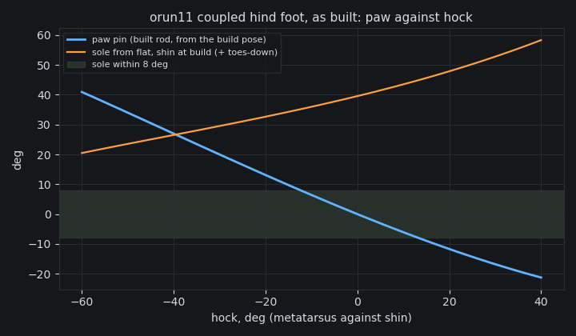

# orun11 iteration 7: the turnbuckle trimmed, M1's static check passes; heel1-s1 judged

Verified against source: 2026-10-19. Frozen evidence (orun11, iteration 7).

## The trim

At 07a92830 the plantigrade clip's push-off put the hock case on the floor
on both legs but left the sole 9.1° (LH) and 10.3° (RH) toes-up, outside
M1's 8° (`plantigrade-clip.md`). The rod's length sets the paw's angle at
a given hock angle, so the fix is the turnbuckle.

orun11-cat's script now has `rod_trim` (deg, toes-down positive, default
10). It re-seats the paw on the rod at the build pose (`PAW_SEAT = -36 +
65.55 + rod_trim`), and the rod's length follows from the seat, as a
turnbuckle's does. At 10° the rod is **101.24 mm** between centres, against
95.67 mm before. That is +5.6 mm on a 20 mm M5 LH/RH turnbuckle, taken up
in the studs' thread engagement. The rod ends, studs, lug and horn are
unchanged.

The same build fixes a wrong comment in the script. The comment blamed the
first refused plantigrade export on the 50 mm swing. The project's stored
`gallop_duty` of 0.25 caused it, and the plantigrade clip now has its own
`heel_duty`.

Accepted as **ca32a9b4** (`cadex script --set`, project commit `e6413f9`):

- fit **pass**: 0 failing of 7,626 pairs;
- mounting **pass**: 30 of 30;
- panels: 0 failing of 45, 12 advisory;
- sweep **incomplete**: 29 of 36 limited joints swept with no failing pair.
  This is the same as 07a92830: `j_tail1`–`j_tail7` hit the 90 s per-joint
  bound. The tail did not change. `plantigrade-clip.md` has those seven
  joints swept offboard with no common volume.

## M1's static check, in the new clip's stance pose

The engine regenerated the clip on the new paw. The clip is the same as
before: rotary, 0.7 m at 2.4 Hz, duty 0.2, swing 40 mm, plantigrade.
`clip_static.py` was run on ca32a9b4's exported model and gallop task:

| foot | sample | sole pitch (deg, + toes-down) | hock case over floor (mm) | heel held |
|---|---|---|---|---|
| LH | 0 (touchdown) | −2.5 | 33.9 | no |
| LH | 1 | +4.3 | 42.0 | no |
| LH | 2 | +11.2 | 51.2 | no |
| LH | 3 | −2.4 | 0.0 | yes |
| LH | **4 (push-off)** | **+1.6** | **0.0** | yes |
| RH | 2 (touchdown) | +0.8 | 39.5 | no |
| RH | 3 | +8.3 | 48.0 | no |
| RH | 4 | −5.3 | 0.0 | yes |
| RH | **5 (push-off)** | **+0.2** | **0.0** | yes |

**M1's static check passes on both legs.** At push-off the sole is 1.6°
(LH) and 0.2° (RH) from flat, against an 8° limit. The hock case is on the
floor (0.0 mm, against a 10 mm limit). The rod's closures hold to 0.000 mm.
Before the trim the push-off soles were −9.1° and −10.3°, so the trim moved
them by 10.7° and 10.5°: the 10° of the seat, nearly one for one.

## The coupling curve and the link loads

From `foot_static.py` on ca32a9b4's model. The left and right legs agree to
the printed digit.



| | 07a92830 (95.67 mm rod) | ca32a9b4 (101.24 mm rod) |
|---|---|---|
| paw pin against hock, least squares | pin = +0.8 − 0.611 × hock (rms 0.65°) | pin = +1.2 − 0.635 × hock (rms 1.08°) |
| sole at the build pose | +29.6° | +39.6° |
| sole at hock −60, shin at build | +7.2° | +20.5° |
| level-trunk check passes for shin pitch | −2..−20° | −16..−28° |
| rod force, 3× body weight up the toes, hock −60 | 1,069 N (Euler margin 2.9×) | 1,254 N (Euler margin 2.2×) |
| the same, hock 0 / +40 | — | 876 / 876 N (3.2×) |
| M5 pin, double shear, at hock −60 | 27.2 MPa | 31.9 MPa |

The longer rod cuts the rod's lever about the paw pin at a folded hock,
from 25.9 to 22.1 mm. So the worst rod load rises by 17%, and the rod's
Euler margin on its 4.1 mm thread root falls from 2.9× to 2.2×. It still
carries the push. The 3× body-weight push is 924 N on a 31.4 kg model, a
27.7 N·m pin moment.

The level-trunk check passes at a steeper shin, −16 to −28°, which is where
the clip's crouched trunk stands the shin at push-off. That is why the
clip's own pose is the check M1 counts.

## heel1-s1, judged

heel1-s1 trained on 07a92830, before the trim. It was cold, 150 iterations,
rod1-s1's 17 terms, on the plantigrade clip (`plantigrade-clip.md`).
Each checkpoint was judged on the bundle's ADR-774 `gallop_spec`, seeds
1001–1010:

```
PYTHONPATH=cli pixi run python docs/probes/orun11/judge.py PROJECT RUN/train POLICY NAME
python3 docs/probes/orun11/summarize.py PROJECT/evaluations/NAME ...
```

`judge.py` now takes `accepted_revision` from the run's own `run.json`, so
these reports name 07a92830, the revision the policy trained on. Before,
it took the project's current revision, which had moved on to ca32a9b4.
`summarize.py` is new: one row per `evaluation.json`.

| checkpoint | pass | failing (median, passes) | top 2 s m/s min / med / max | hock down LH / RH | hock at toe-off LH / RH | hock stance height LH / RH mm | sole LH / RH deg | touchdown Hz LF RF LH RH | stride Hz | worst RMS/rated | peak ratio | falls |
|---|---|---|---|---|---|---|---|---|---|---|---|---|
| 25 | 0/10 | completes 1 (7/10); upright 21.9 (7/10); straight 24.3 (6/10); top_speed 870 (0/10); hock_down 0.0524 (0/10); hock_at_toeoff 0 (0/10); no_tap 1.49 (0/10); every_stride 0.98 (7/10); overreach -494 (0/10) | 0.42 / 0.87 / 1.15 | 0.24 / 0.05 | 0.05 / 0.00 | 19 / 76 | 19 / 71 | 3.44 2.89 2.44 2.44 | 2.38 | 1.98 (j_hock_l) | 1.00 | 0 |
| 50 | 0/10 | top_speed 1.78e+03 (0/10); hock_down 0 (0/10); hock_at_toeoff 0 (0/10); no_tap 1.31 (0/10); overreach -265 (0/10) | 1.76 / 1.78 / 1.80 | 0.46 / 0.00 | 0.00 / 0.00 | 2 / 79 | 15 / 77 | 2.44 3.06 2.72 2.44 | 2.38 | 1.84 (j_spine) | 1.00 | 0 |
| 75 | 0/10 | top_speed 2.59e+03 (0/10); hock_down 0 (0/10); hock_at_toeoff 0 (0/10); no_tap 1.63 (0/10) | 2.56 / 2.59 / 2.63 | 0.43 / 0.00 | 0.14 / 0.00 | 2 / 88 | 16 / 71 | 2.44 3.89 2.44 2.44 | 2.38 | 2.04 (j_spine) | 1.00 | 0 |
| 100 | 0/10 | top_speed 3.09e+03 (0/10); hock_down 0 (0/10); hock_at_toeoff 0 (0/10); no_tap 1.91 (0/10) | 3.01 / 3.09 / 3.18 | 0.50 / 0.00 | 0.30 / 0.00 | 1 / 87 | 14 / 69 | 2.44 4.56 2.67 2.44 | 2.38 | 2.04 (j_spine) | 1.00 | 0 |
| 125 | 0/10 | top_speed 3.39e+03 (0/10); hock_down 0 (0/10); hock_at_toeoff 0 (0/10); no_tap 1.96 (0/10) | 3.33 / 3.39 / 3.41 | 0.46 / 0.00 | 0.20 / 0.00 | 2 / 90 | 14 / 65 | 2.44 4.67 2.39 2.56 | 2.38 | 2.01 (j_spine) | 1.00 | 0 |
| best (149) | 0/10 | top_speed 3.51e+03 (0/10); hock_down 0 (0/10); hock_at_toeoff 0 (0/10); no_tap 2.01 (0/10) | 3.49 / 3.51 / 3.52 | 0.50 / 0.00 | 0.37 / 0.00 | 1 / 90 | 12 / 62 | 2.44 4.78 2.44 2.94 | 2.38 | 1.94 (j_spine) | 1.00 | 0 |
| final (150) | 0/10 | top_speed 3.51e+03 (0/10); hock_down 0 (0/10); hock_at_toeoff 0 (0/10); no_tap 2.01 (0/10) | 3.49 / 3.51 / 3.52 | 0.50 / 0.00 | 0.37 / 0.00 | 1 / 90 | 12 / 62 | 2.44 4.78 2.44 2.94 | 2.38 | 1.94 (j_spine) | 1.00 | 0 |

These are medians over 10 seeds. Hock-down, stance height and sole (the
median pitch from flat in stance, toes-down positive) are per leg; the
predicate takes the worse leg. Worst RMS/rated is each seed's worst drive,
then the median. The peak ratio of 1.00 is a drive at its clamp, a peak
margin of 0. No seed fell. Seeds that tipped at 25 have no 2 s average and
are left out of its speed, as the engine's predicate leaves them out. The
run is cold, with no warm start. It ended at 150 iterations in 4,773 s,
inside its 7,200 s budget.

**What it shows.**

- **The clip lays down the left hind only.** LH's hock case is down 43–50%
  of stance from 50 on. It meets P1's 40%. Its median stance height is 1–2
  mm, and at the end it is down at 37% of toe-offs. P1 asks for every
  toe-off. **RH never lays down:** 0.00 at every checkpoint, the case 79–90
  mm up, the sole 62–77° toes-down. rod1-s1 on the tiptoe clip had the
  mirror image (LH 0.06, RH 0.45). One hind lays down, and which one is the
  policy's choice; the clip asks for both.
- **The right fore taps:** 4.6–4.8 Hz against a 2.38 Hz stride from 100 on.
  That is t2-g4's and eq1-s1's mid-swing tap. `no_tap` takes the worst paw:
  2.01.
- **Speed** climbs at every checkpoint, to **3.51 m/s** at 150 (min 3.49,
  max 3.52), on the clip's 2.38 Hz clock. That is the fastest plantigrade-
  clip policy so far, above rod1-s1's 3.19, and 3.5% over iteration 125.
  The spine is the worst drive, at 1.9–2.0× rated RMS.
- **The trainer's best is the final:** iteration 149 has 28.66 reward per
  step, and the best and final are judged seed for seed the same.

## Next: trim1-s1

Started cold on ca32a9b4 when heel1-s1 ended. It uses the same clip
settings and the same 17 terms, so the trimmed foot is the one variable:
150 iterations, 8,192 envs, unroll 20, seed 0, 7,200 s. heel1-s1 was not
extended. Its speed still climbs, but its RH hock-down share stayed at
0.00 at every checkpoint, and it trained on the foot that fails M1's
static check. The trim is a mechanism change, so O7 has it train cold.

**O8 timing.** Iteration 10 came at 449 s, with the trainer's ETA at 5,677 s
more, so the run should end about 6,100 s after its start, inside the
budget. Iteration 10's reward/step is 10.61 against heel1-s1's 10.65.
Unjudged.
