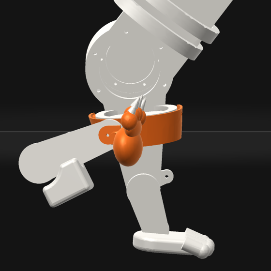

# orun12 Q2 (O9): the P1 policy on the real meshes

Verified against source: 2026-10-20. Frozen evidence (orun12, iteration 19).

## What was measured

The P1 policy is heel5c-s1's final `gallop.cxpolicy` (`910cdb5a`, iteration
105, `heel5c-final.md`). Its 10-seed `gallop_spec` evaluation
(`evaluations/heel5c-s1-final`) was replayed against the real part meshes
with `trace_check.py` (method and engine cross-check in `o9-baseline.md`).
The first second is excluded. The check ran on 10 CPU workers beside heel7-s1's
training and took 9 minutes:

```
CUDA_VISIBLE_DEVICES= PYTHONPATH=cli pixi run python docs/probes/orun12/trace_check.py \
    ~/cadex-projects/feline-v07 ~/cadex-projects/feline-v07/runs/heel5c-s1/train/cat_model-model.xml \
    ~/cadex-projects/feline-v07/evaluations/heel5c-s1-final --jobs 10
```

## O9, item by item

- **No NaN or blow-up: passes.** On all 10 seeds the episode runs its 500 steps
  to truncation, with no termination and no solver warnings
  (`evaluation.json`, `seeds[].episode`).
- **Loops closed within 2 mm: fails, on the fore rods only.** The engine's
  `closure` rows and the mesh replay agree:

  | loop | median mm | worst mm |
  |---|---|---|
  | `j_frodbot_l` | 0.20 | **2.71** |
  | `j_frodbot_r` | 0.22 | **2.86** |
  | `j_rodbot_l` | 0.13 | 1.45 |
  | `j_rodbot_r` | 0.14 | 1.26 |

  The fore rod ends exceed 2 mm on every seed (worst per seed 2.45–2.86 mm).
  The hind loops, which the heel loads, stay under the bar. The 2.9 mm that
  `heel5c-final.md` cites is the fore rod.
- **No real-mesh interpenetration deeper than 5 mm: fails.** There are 6 pairs,
  against 12 on v07-g1-best. Each pair below lists its frames over seeds, its
  deepest overlap, the seeds it appears in, and where the deepest one is:

  | pair | frames | deepest mm | seeds | deepest at |
  |---|---|---|---|---|
  | c_paw_hr × c_pnl_forearm_r_outer | 205 | 8.5 | 10 | seed 1003, 4.08 s |
  | c_humerus_r × c_paw_hr | 5 | 6.7 | 4 | seed 1003, 6.58 s |
  | c_forearm_r × c_paw_hr | 29 | 6.5 | 9 | seed 1010, 3.38 s |
  | c_chest_frame × c_qdd_wrist_r | 117 | 6.3 | 10 | seed 1008, 9.58 s |
  | c_battery_6s_standin × c_forearm_r | 5 | 5.3 | 4 | seed 1007, 4.08 s |
  | c_chest_frame × c_forearm_r | 4 | 5.3 | 4 | seed 1004, 4.56 s |



## What it shows

- **The chest-box fix (`o9-chest.md`) mostly holds.** The wrist drive in
  the chest frame fell from 17.7–18.4 mm on v07-g1-best to 6.3 mm, on the
  right only. All four battery × fore crank and rod pairs are gone.
- **The new failure is the right hind paw reaching the right fore leg.** The
  hind paw swings forward past the forearm at the overreach, and on all 10
  seeds it passes 8.5 mm into the forearm's outer panel. It also reaches the
  forearm itself (6.5 mm) and the humerus (6.7 mm). The left side has no such
  pair, so this is one more right-hand asymmetry of this policy, and it
  should be checked with O3's mirror test before any fix.
- **Why the sim allows it.** `c_pnl_forearm_r_outer` has no collision geom
  in the MJCF. The hind paw's capsules (contype 2, conaffinity 3) do collide
  with the forearm's capsule (contype 8, conaffinity 11), but that 28 mm
  capsule does not cover the real forearm mesh, so the meshes overlap 6.5 mm
  while the capsules only touch.
- **The floor.** The fore paw meshes reach 17.5 mm under the floor and the
  fore claws 11.0 mm, as on v07-g1 (the mesh sits below its collision geom).
  The hind heel meshes reach 6.1 mm (LH) and 7.0 mm (RH), and the hind paws
  3.2 and 3.5 mm. O9 bars only part-against-part overlap, so the floor is
  reported, not judged.
- **Heel at toe-off on the meshes reads 0.00.** The engine reads 1.0 on 8
  of 10 seeds, and P1 is judged by the engine. The difference is in the
  definitions. The replay calls toe-off the last frame the paw *mesh* is
  within 8 mm of the floor. The heel's 8 mm bar clears first, as the paw
  rolls onto its toes. The engine reads the contact geoms at the last
  stance contact, and `toeoff.py` matches it on every seed. The mesh heel
  share in stance is 0.68 / 0.70, against the engine's 0.61 / 0.61.

## Q2 verdict on 910cdb5a

**Q2 fails** on two counts: the fore rod loops (2.71 / 2.86 mm against
2 mm), and 6 mesh pairs over 5 mm. The deepest of those is the right hind paw
in the right forearm panel, at 8.5 mm on 10 of 10 seeds. Nothing blew up.

## The warm dynamics fine-tune the critic asked for is refused by the trainer

The trainer will not warm-start from `910cdb5a` onto a model with another
`pin_damp` or equality `solref`. `check_policy_fits` refuses a changed model
digest unless the curriculum names `model`. A curriculum that names it is
held to ADR-736: "a warm start may move the robot onto another course, never
change the robot" (`training/cadex_train.py`, `check_curriculum_change`).
Joint damping is part of the robot's export. Every O1 dynamics fix (pin
damping, a stiffer fore-rod `solref`, a collision geom on the forearm panel)
therefore needs a cold run, or a trainer change behind an ADR. Also, the
equality `solref` (0.004) is emitted for every `connect` in the export. It
is not a declared parameter in `feline-v07/script.py`, so stiffening it
alone is not a script-value change.
