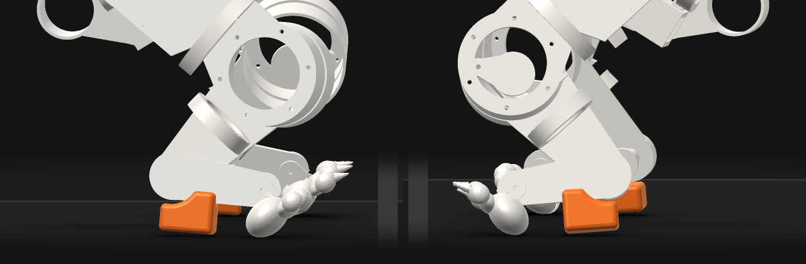

# orun12 P1 (O2a): heel5c-s1's final policy passes P1 on both hind legs

Verified against source: 2026-10-20. Frozen evidence (orun12, iteration 18).

heel5c-s1 continues heel5-s1 on its own task (`816db7e7`, revision
`44411418`; see `heel5c-25.md` and `heel5c-50.md`). Its last two checkpoints,
`gallop.000075.cxpolicy` and `gallop.000100.cxpolicy` (about 170 and 195
actor iterations in all), and its final policy `gallop.cxpolicy` (iteration
105, about 200 in all, sha256 `910cdb5a`) were judged on the bundle's `gallop_spec`, seeds
1001–1010, on the CPU:

```
CUDA_VISIBLE_DEVICES= PYTHONPATH=cli pixi run python docs/probes/orun11/judge.py \
    ~/cadex-projects/feline-v07 RUN/train RUN/train/gallop.000075.cxpolicy heel5c-s1-75
CUDA_VISIBLE_DEVICES= PYTHONPATH=cli pixi run python docs/probes/orun11/judge.py \
    ~/cadex-projects/feline-v07 RUN/train RUN/train/gallop.000100.cxpolicy heel5c-s1-100
CUDA_VISIBLE_DEVICES= PYTHONPATH=cli pixi run python docs/probes/orun11/judge.py \
    ~/cadex-projects/feline-v07 RUN/train RUN/train/gallop.cxpolicy heel5c-s1-final
python3 docs/probes/orun12/legs.py EVALS/{heel5c-s1-50,heel5c-s1-75,heel5c-s1-100,heel5c-s1-final}
python3 docs/probes/orun12/toeoff.py RUN/train/cat_model-model.xml EVALS/{heel5c-s1-50,heel5c-s1-75,heel5c-s1-100,heel5c-s1-final}
python3 docs/probes/orun12/paw_pin.py EVALS/{heel5c-s1-75,heel5c-s1-100,heel5c-s1-final}
```

| checkpoint | pass | hock down LH / RH | at toe-off LH / RH | heel mm LH / RH | top 2 s m/s min / med / max | touchdown Hz LH / RH | stride mm LH / RH | overreach mm LH / RH | flight share / s | rotary | no_tap | worst RMS/rated | peak margin | loop gap mm | pin >900 deg/s LH / RH |
|---|---|---|---|---|---|---|---|---|---|---|---|---|---|---|---|
| heel5c-s1-50 | 0/10 | 0.44 / 0.51 | 0.82 / 0.95 | 3 / 1 | 3.05 / 3.22 / 3.27 | 2.33 / 2.44 | 1290 / 1300 | 351 / 365 | 1.00 / 0.240 | 107/175 | 6/10 (1.03) | 2.03 (j_spine) | 0.00 | 2.7 | 0.11 / 0.15 |
| **heel5c-s1-75** | 0/10 | **0.57 / 0.57** | **1.00 / 1.00** | 0 / 0 | 2.84 / 2.90 / 2.94 | 2.44 / 2.39 | 1176 / 1177 | 267 / 303 | 1.00 / 0.260 | 54/165 | 10/10 (1.03) | 2.01 (j_spine) | 0.00 | 2.8 | 0.15 / 0.14 |
| heel5c-s1-100 | 0/10 | 0.57 / 0.63 | 0.98 / 1.00 | 0 / 0 | 2.63 / 2.67 / 2.71 | 2.39 / 2.44 | 1092 / 1091 | 220 / 239 | 1.00 / 0.260 | 51/173 | 10/10 (1.03) | 2.01 (j_spine) | 0.00 | 2.8 | 0.11 / 0.16 |
| **heel5c-s1-final** | 0/10 | **0.60 / 0.61** | **1.00 / 1.00** | 0 / 0 | 2.81 / 2.91 / 3.01 | 2.33 / 2.39 | 1168 / 1169 | 279 / 286 | 1.00 / 0.260 | 54/176 | 10/10 (1.03) | 2.01 (j_spine) | 0.00 | 2.9 | 0.10 / 0.15 |

Medians over seeds. Every checkpoint fails `top_speed` on 10/10 seeds.
`completes`, `no_fall`, `upright`, `straight`, `every_stride` and
`overreach` pass 10/10 on all three. At 75, 100 and final, `no_tap` passes
10/10 and `hock_down` passes 10/10 on both legs. The engine's
`hock_at_toeoff` (the worse leg) passes 6/10 at 75, 4/10 at 100 and
**8/10 on the final policy**.

## P1, per seed and per leg

Heel share / toe-off share. P1 needs share ≥ 0.40 and toe-off = 1 on each
leg, on 8 of 10 seeds:

```
         heel5c-s1-75                    heel5c-s1-100
seed   LH           RH           P1    LH           RH           P1
1001   0.57 / 1.00  0.59 / 1.00  yes   0.57 / 0.95  0.67 / 1.00  --
1002   0.60 / 1.00  0.57 / 1.00  yes   0.59 / 1.00  0.65 / 1.00  yes
1003   0.57 / 1.00  0.57 / 1.00  yes   0.61 / 1.00  0.64 / 1.00  yes
1004   0.57 / 1.00  0.57 / 1.00  yes   0.58 / 0.95  0.62 / 1.00  --
1005   0.53 / 0.95  0.55 / 1.00  --    0.55 / 0.91  0.61 / 0.95  --
1006   0.59 / 1.00  0.56 / 1.00  yes   0.55 / 1.00  0.59 / 1.00  yes
1007   0.61 / 0.95  0.57 / 1.00  --    0.54 / 0.95  0.65 / 1.00  --
1008   0.54 / 0.91  0.56 / 1.00  --    0.59 / 1.00  0.62 / 0.95  --
1009   0.57 / 1.00  0.57 / 1.00  yes   0.58 / 0.95  0.61 / 1.00  --
1010   0.61 / 1.00  0.54 / 0.95  --    0.56 / 1.00  0.65 / 1.00  yes
```

Final policy (`gallop.cxpolicy`, `910cdb5a`), from `evaluation.json`'s
`detail.heels`, heel share / toe-off share (toe-offs, median heel height in
stance):

```
seed   LH                             RH                             P1
1001   0.561 / 1.000 (21, 0.3 mm)     0.625 / 1.000 (21, 0.2 mm)     yes
1002   0.629 / 1.000 (21, 0.1 mm)     0.600 / 1.000 (21, 0.4 mm)     yes
1003   0.656 / 1.000 (21, 0.2 mm)     0.618 / 1.000 (21, 0.3 mm)     yes
1004   0.606 / 1.000 (21, 0.1 mm)     0.611 / 1.000 (21, 0.2 mm)     yes
1005   0.600 / 0.955 (22, 0.3 mm)     0.610 / 0.955 (22, 0.3 mm)     --
1006   0.603 / 1.000 (22, 0.2 mm)     0.600 / 1.000 (22, 0.3 mm)     yes
1007   0.619 / 1.000 (21, 0.3 mm)     0.608 / 0.955 (22, 0.3 mm)     --
1008   0.603 / 1.000 (21, 0.4 mm)     0.613 / 1.000 (22, 0.3 mm)     yes
1009   0.642 / 1.000 (22, 0.3 mm)     0.637 / 1.000 (22, 0.4 mm)     yes
1010   0.577 / 1.000 (22, 0.3 mm)     0.615 / 1.000 (22, 0.4 mm)     yes
```

| checkpoint | leg | hock_down ≥ 0.40 | hock_at_toeoff = 1 | both legs on one seed |
|---|---|---|---|---|
| heel5c-s1-75 | LH | **10/10** | 7/10 | 6/10 |
| heel5c-s1-75 | RH | **10/10** | **9/10** | |
| heel5c-s1-100 | LH | **10/10** | 5/10 | 4/10 |
| heel5c-s1-100 | RH | **10/10** | **8/10** | |
| **heel5c-s1-final** | LH | **10/10** (0.56–0.66) | **9/10** | **8/10** |
| **heel5c-s1-final** | RH | **10/10** (0.60–0.64) | **8/10** | |

**P1 passes on heel5c-s1's final policy.** On 8 of 10 seeds (all but 1005
and 1007) `hock_down` and `hock_at_toeoff` pass for each hind leg. The heel
share is 0.60 / 0.61 (median), and the heel's median stance height is
0.1–0.4 mm on every seed and leg. All three failing toe-offs (1005 LH and
RH, 1007 RH) are the first counted toe-off, at t = 1.00–1.02 s, the
start-up transient described below.

The still `heel5c-final-heels.png` is seed 1001 at 5.08 s (trace frame 255),
side-on from the right (left image) and the left (right image). Both heels
(orange) and both paws are on the floor: in the trace at that frame the
heels are at 0.1 / −0.1 mm and the paw soles at −0.4 / −0.6 mm (LH / RH),
by the engine's `foot_series`.



The earlier checkpoints:

At 75, both heels are down on 0.57 of stance,
1% apart, on every seed. The right leg meets P1 (10/10, 9/10). The left
misses by one seed on `hock_at_toeoff` (7/10 against 8). From 75 to 100 the
heel share holds, but toe-off slips (LH 7 → 5), speed falls from 2.90 to
2.67 m/s, and overreach falls from 267 to 220 mm. The last five iterations (100 → 105)
brought both back: toe-off 9/10 and 8/10, 2.91 m/s, overreach 279 mm. The
trainer's own best was iteration 99 (reward 41.09/step), which the engine
judges worse; the trainer's reward is not a pass. The swing from 100 to 105
says the toe-off pass sits near the bar, not well past it.

## How toe-off fails (`toeoff.py`)

`hock_at_toeoff` counts a toe-off when the paw's last stance frame (sole
within 1 mm) is followed by a lift. It passes the toe-off when the heel is
down in some stance frame of the last 40 ms, which is three 20 ms trace
frames.

| checkpoint | leg | toe-offs | pass | failing: heel last down 60–80 ms before | failing: heel never down in that stance | stance ms pass / fail |
|---|---|---|---|---|---|---|
| heel5c-s1-50 | LH | 215 | 0.85 | 31 | 2 | 60 / 60 |
| heel5c-s1-50 | RH | 216 | 0.95 | 7 | 3 | 60 / 80 |
| heel5c-s1-75 | LH | 216 | 0.98 | 0 | 4 | 40 / 0 |
| heel5c-s1-75 | RH | 216 | 1.00 | 1 | 0 | 40 / 60 |
| heel5c-s1-100 | LH | 215 | 0.97 | 0 | 6 | 40 / 0 |
| heel5c-s1-100 | RH | 216 | 0.99 | 0 | 2 | 40 / 10 |
| heel5c-s1-final | LH | 214 | 1.00 | 0 | 1 | 40 / 0 |
| heel5c-s1-final | RH | 216 | 0.99 | 0 | 2 | 60 / 0 |

The per-seed shares match the engine's `heel_down_at_toeoff_share` on every
seed.

- **At 50 the heel lifted one frame too early.** Its last frame on the floor was
  60 ms before toe-off on 37 toe-offs and 80 ms on one, outside the 40 ms window, with the
  metatarsus at 62–67° (38–40° on passing toe-offs).
- **At 75, 100 and final that failure is gone.** Nearly every failure is now a
  one-frame stance. The heel lands first, and the paw follows. The paw
  touches the floor on a single frame and lifts again. In that frame the
  heel has risen 2–28 mm, so no stance frame has it down. Up to 20 ms
  earlier it was on the floor.
- **The failures sit in the first strides.** At 75, 4 of the 5 failing
  toe-offs fall at t = 1.00–1.44 s, the first strides after the engine's
  1 s settle. The fifth is RH on seed 1010 at 9.36 s. At 100, 7 of the 8 fall
  at t = 1.00–1.42 s, and the eighth at 4.98 s (1009 LH). On the final policy all 3 fall
  at t = 1.00–1.02 s. The seeds that fail at 75 (1005, 1007, 1008 LH) all fail at 1.00 or
  1.40–1.44 s.

  So in the steady gallop the heel is down through toe-off on every stride
  of every seed but one at 75, and on every stride of every seed on the
  final policy. What remains is the start-up transient: the first one or
  two hind strides out of the reset, where the paw kisses the floor for
  20 ms after a heel strike. It costs the final policy seeds 1005 and 1007.

  The spec is not changed. Those strides count.

## Other measures on the final policy (for the record)

- **Q1 inputs.** The legs are 1% apart on heel share, 0% on toe-off, 0% on
  stride and 2% on touchdown rate, all inside Q1's 20%. Overreach is 3%
  apart. Q1 is judged on a P1/P2 policy, and P2 is not met (below).
- **P2 inputs.**
  - `no_tap`, `every_stride` and `overreach` pass 10/10, with a median
    overreach of 279 / 286 mm.
  - Flight comes every stride, at 0.260 s.
  - **Rotary fails**: 54 of 176 ordered strides are rotary, and 32 are
    unordered. P2's rotary order is the open half.
- **Speed.**
  - The top 2 s speed went from 3.22 m/s at 50 to 2.90 at 75, 2.67 at 100
    and 2.91 at the end, with the speed command unchanged.
  - Stride went from 1290 to 1176, 1092 and 1168 mm, at a constant
    2.38 Hz.
  - The heel was bought with stride length.
- **O4.** The worst drive is `j_spine` at 2.01× rated RMS. The peak margin
  is 0.00, a drive at its clamp, as on every v07 policy.
- **O9 / Q2 still fail.**
  - The push-rod loop gap peaks at 2.9 mm, against a 2 mm bar.
  - The hind paw pin snaps faster than 900°/s on 10% / 15% of frames.
  - heel7-s1 is cold, on `pin_damp` 3.0 and the flat clip, and started as
    heel5c-s1 ended (05:52:47). It is the screen for the pin. Timed for
    O8, it reached iteration 10 in 950 s, as heel6-s1 did (953 s). The
    trainer's ETA then was 7,180 s more, about 8,130 s in all, inside its
    `budget_s` of 9,000.
  - Mesh interpenetration on these traces is not yet measured.

## Next

P1 is met, on `heel5c-s1/train/gallop.cxpolicy` (`910cdb5a`), but with no
margin: 8/10 against a bar of 8, and the two failing seeds fail on their
first toe-off.

By the question policy's order, Q2 (clean simulation) comes next on this
policy, then P2's rotary order.

A warm continuation of this task loses stride, so any fine-tune from this
policy watches speed. A toe-off term for the first strides (an O2a
termination, or `heel_pitch` paid on the paw's own contact) would add
margin to P1. It is measured per step on the bundle first (O5).
