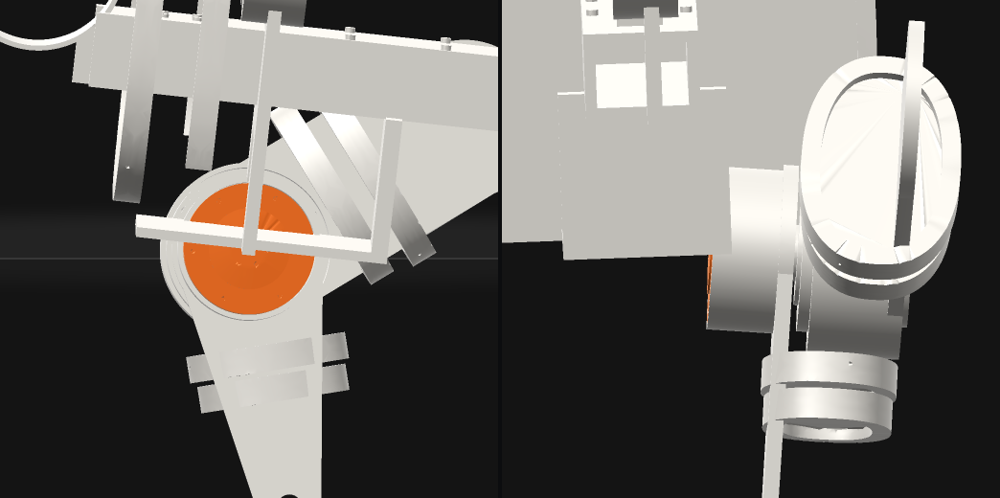

# orun12 O9/Q2: the trace check, and v07-g1 on the real meshes

Verified against source: 2026-10-19. Frozen evidence (orun12, iteration 3).

## The probe

`trace_check.py` replays a judged evaluation's `seed-*-trace.json` (every
component's world placement, 50 frames a second) against the real part
meshes the accepted attempt retained, independently of the engine's contact
readings. Per seed and over seeds, after the first second:

- per hind leg: heel stance share, heel share at toe-off, median stance
  height (a paw is in stance when its paw or claws mesh is under 8 mm; the
  heel is down under 8 mm);
- every `equality/connect` rod loop's median and worst gap (O9's 2 mm bar);
- flight per stride (left-hind touchdown to touchdown; no paw, claws or
  heel mesh under 8 mm);
- real-mesh interpenetration deeper than 5 mm between parts that do not
  touch in the build pose (`qpos0`), and each lower-leg part's deepest point
  below the floor.

```
CUDA_VISIBLE_DEVICES= PYTHONPATH=cli pixi run python docs/probes/orun12/trace_check.py \
    ~/cadex-projects/feline-v07 RUN/train/cat_model-model.xml \
    ~/cadex-projects/feline-v07/evaluations/<tag>
PYTHONPATH=cli pixi run python docs/probes/orun12/render_frame.py \
    ~/cadex-projects/feline-v07 <trace> <time_s> out.png --parts ... --hot ...
```

Interpenetration is found in two stages. Convex hulls of the meshes on free
MuJoCo bodies are the broadphase; hulls alone are wrong for a concave part
(on hulls alone, the chest frame swallows the scapulae, yokes and
loin link, 38–72 mm deep, while their real meshes are clear). Each candidate is then measured on the real triangles: faces
welded and wound outward, a KD-tree sign estimate, ray parity on two rays
that must agree, and exact point-to-triangle depth. Parts on one MuJoCo
body are skipped (they cannot move apart). A 10-seed evaluation takes about
19 minutes on 10 CPU workers beside a training run, so run it in the
background. It needs `scipy`, already in the pixi environment.

**Checked against the engine on v07-g1-best** (the iteration-99 policy):

| reading | engine (`evaluation.json`) | `trace_check.py` |
|---|---|---|
| heel down share LH / RH, every seed | 0.00 / 0.00 | 0.00 / 0.00 |
| j_frodbot_l worst / median gap mm | 1.860 / 0.285 | 1.86 / 0.29 |
| j_frodbot_r | 2.697 / 0.254 | 2.70 / 0.25 |
| j_rodbot_l | 0.785 / 0.143 | 0.78 / 0.14 |
| j_rodbot_r | 1.671 / 0.158 | 1.67 / 0.16 |
| flight stride share / median flight s | 1.00 / 0.200 | 1.00 / 0.120 |

The loop gaps agree to 0.01 mm, which shows that a component's placement is
its MuJoCo body frame. Flight is shorter on the meshes because a fore paw's
mesh sits up to 17 mm below its collision geom (below), so the mesh is
"down" longer than the contact is.

## v07-g1-best on the real meshes

- **Heels:** never under 8 mm in stance on either leg. Median stance height
  is **33 mm LH and 72 mm RH**; the engine's geom-based readings are 31 / 75.
- **Rod loops:** `j_frodbot_r` opens to **2.70 mm**, over 2 mm (seeds 1005,
  1007, 1008). The others are at most 1.86 mm.
- **Floor:** fore paw and claw meshes reach **16.9 mm** under the floor (paw
  fr) and 14.8 mm (claws fl); the hind ones 7.6 mm (claws hr). Only the
  collision geoms meet the floor.
- **Interpenetration over 5 mm, in all 10 seeds** (frames over seeds,
  deepest):

| pair | frames | deepest mm | deepest at |
|---|---|---|---|
| c_chest_frame × c_qdd_wrist_l | 1717 | 18.4 | seed 1001, 2.76 s |
| c_battery_6s_standin × c_rod_fr | 565 | 18.1 | |
| c_chest_frame × c_qdd_wrist_r | 1892 | 17.7 | |
| c_battery_6s_standin × c_rod_fl | 529 | 14.0 | |
| c_battery_6s_standin × c_crank_fr | 495 | 12.7 | |
| c_chest_frame × c_qdd_elbow_r | 977 | 10.8 | |
| c_battery_6s_standin × c_crank_fl | 418 | 8.4 | |
| c_battery_6s_standin × c_forearm_r | 106 | 7.7 | |
| c_battery_6s_standin × c_qdd_wrist_r | 115 | 7.6 | |
| c_chest_frame × c_qdd_elbow_l | 34 | 6.2 | |
| c_chest_frame × c_forearm_l | 19 | 5.9 | |
| c_chest_frame × c_forearm_r | 11 | 5.3 | |

(Per-seed "deepest at" is printed by the current probe; the run above
predates that column, and the 1001 / 2.76 s frame was found by measuring
that pair alone.)



At seed 1001, 2.76 s (shoulder 22°, elbow 34°, wrist −33°), the fore leg is
folded back under the torso and the AK60-6 wrist drive's inboard face is
inside the chest frame's lower rails.

**Why the sim allows it:** the contact filter. The chest frame's one
collision box is contype 4 / conaffinity 1; the fore limbs' geoms
(`c_forearm_*`, `c_qdd_wrist_*`) are contype 8 / conaffinity 11. Since
4 & 11 = 0 and 8 & 1 = 0, they never collide. The battery stand-in, the fore
cranks and the fore rods carry no collision geom at all. So v07's "capsules
for every limb" stop the hind paw passing the forearm (no hind pair is
listed), but nothing keeps the fore leg out of the torso.

**O9 verdict on v07-g1-best:** it fails twice, on the 2.70 mm fore rod gap
and on 12 pairs over 5 mm. No NaN or blow-up: every seed completes with no
fall.

**Candidate fixes within O1** (contact parameters and joint stops, not
geometry), for a later screen:
- let the chest box collide with the fore-limb group (its conaffinity, or
  the limbs' contype);
- add the fore joint stops that keep the elbow and wrist out of the torso;
- stiffen or damp the fore rod ends (`j_frodbot_*` solref 0.004).

None has been tried yet.
