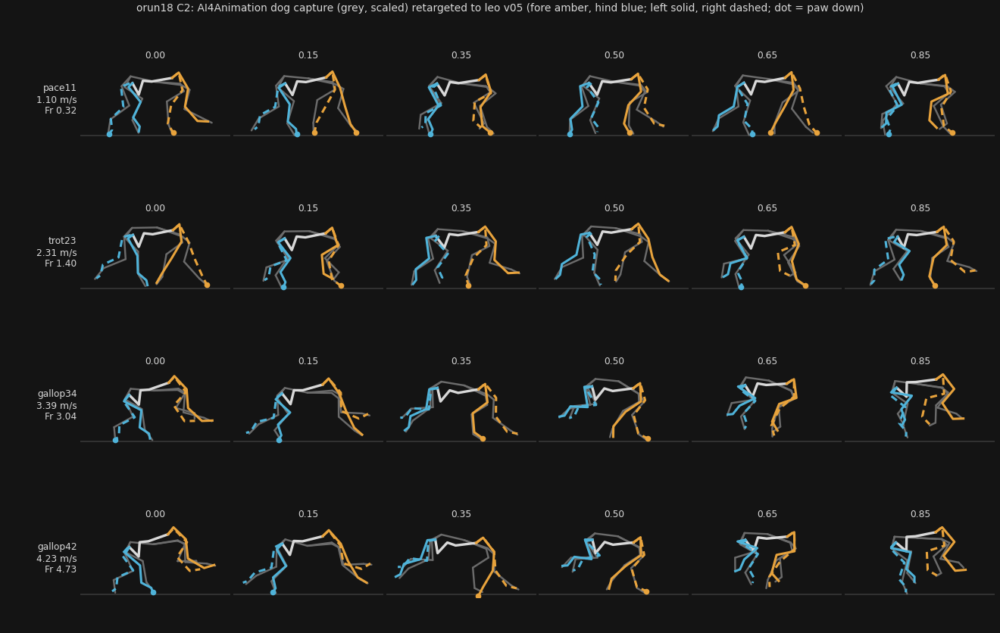

# orun18 C2: the dog capture retargeted to leo v05

Verified against source: 2026-10-23. CPU work while b1-s2 trains (D1).
Probes: `retarget.py` (the retarget), `clip_carry.py` (the engine reads the
clips), `retarget_sheet.py` (the stills). The capture, the clips and their
measures stay in `~/mocap/` (D5: CC BY-NC 4.0, SOURCES.md); only their
sha256 are here.



## The capture, checked

`dog_run01` is take `D1_010_KAN01_002` (`dog_clips_info.txt`). Its BVH, read
whole rather than the keypoint text (which has no frame time and no spine):

- **Units: cm, y up.** Hip pivots stand 0.37–0.41 m above the floor over a
  stride, and shoulder pivots 0.34–0.37 m. That is a dog of leo's size: the
  length scale `s` comes out at 0.98–1.10.
- **Frame rate: 60 fps** (`Frame Time: 0.0166667`). This agrees with
  SOURCES.md's reading of the trims; 155 frames make 2.58 s.
- **Skeleton: 27 joints.** `Hips` (pelvis, root), `Spine` (thorax), `Spine1`,
  `Neck`, `Head`. Each side has `Shoulder` (scapula), `Arm`, `ForeArm`,
  `Hand` and a paw end, and `UpLeg`, `Leg`, `Foot` and a paw end. Then
  `Tail`, `Tail1`. Channels are ZXY Euler. The thorax and pelvis are two
  bodies, so the spine's bend is read between them.
- **Gait (contacts per stride, below).** `dog_run01` holds a **rotary
  gallop**, RH → LH → LF → RF, at 3.6–4.4 m/s over five strides, with 16–30%
  of each stride in flight. `D1_010_KAN01_003` (`dog_run02`) gallops the same
  way at 2.7–3.4 m/s. `D1_031` trots at 2.1–2.3 m/s, and `D1_055` paces
  (lateral pairs together) at 0.8–1.1 m/s.

## The route (retarget.py)

Lengths scale by `s`, leo's girdle pivot height at home over the dog's mean,
per girdle. Times scale by √s, so each stride keeps the dog's Froude number
(Alexander & Jayes 1983).

1. **The spine.** The thorax's pitch and heading against the pelvis's go to
   `j_spine` (its cable follower `j_spine2` follows) and to `j_spine_yaw`, by
   their gains measured on leo (2.0 and 1.0).
2. **The trunk.** It is pitched and raised so leo's shoulder and hip pivots
   follow the dog's, and it moves on with the girdles' midpoint. It has no
   roll or yaw (D9).
3. **The feet.** Each paw target is the dog's paw, scaled. One offset along
   the line moves it to where leo's girdle sits on its trunk; sideways it sits
   at leo's stance width. A paw counts as down when it is within 20 mm of its
   stance level and slower than 0.4 of the trunk. While down, its target is
   held still on leo's ground: the travel this removes is the **raw slip**.
4. **The legs.** Each leg and its push-rod pins are solved by the engine's
   own rows (`CadexGait._leg_rows`, loop closures at `CLOSURE_WEIGHT`). The
   active-set clamp holds every joint inside its range, and what a stop costs
   shows as a foot miss.

All four strides are read on one 26-sample phase grid. A speed schedule
(ADR-773) blends tables row for row, so the strides must share it.

## Result

| stride (take, frames) | dog m/s, Fr | leo m/s, period, Fr | footfall phases (LH LF RF RH) | duty L/R fore, L/R hind | flight |
|---|---|---|---|---|---|
| pace11 (D1_055, 6823–6861) | 1.05, 0.30 | 1.10, 0.660 s, 0.32 | 0.12 0.15 0.62 0.62 | 0.54/0.58, 0.50/0.46 | 0.00 |
| trot23 (D1_031, 568–594) | 2.22, 1.33 | 2.31, 0.451 s, 1.40 | 0.04 0.54 0.00 0.58 | 0.42/0.42, 0.31/0.27 | 0.15 |
| gallop34 (D1_010_003, 86–112) | 3.38, 2.86 | 3.39, 0.435 s, 3.04 | 0.04 0.19 0.38 0.88 | 0.31/0.27, 0.23/0.19 | 0.23 |
| gallop42 (D1_010_002, 66–92) | 4.22, 4.56 | 4.23, 0.435 s, 4.73 | 0.00 0.19 0.38 0.88 | 0.31/0.27, 0.23/0.08 | 0.27 |

Foot slip, miss and limits, all in mm (from `<label>.measure.json`):

| stride | raw slip max LF/RF/LH/RH | solved slip max | foot miss max LF/RF/LH/RH (share > 5 mm) | loop error | limit violations | seam max / largest step |
|---|---|---|---|---|---|---|
| pace11 | 15 / 78 / 12 / 37 | 1.2 | 81 (0.12) / 2 / 0 / 0 | 0.000 | 0 | 11° / 33° (`j_elbow_l`) |
| trot23 | 20 / 23 / 15 / 21 | 2.7 | 8 (0.08) / 16 (0.12) / 0 / 0 | 0.000 | 0 | 35° (`j_carpus_r`) / 30° |
| gallop34 | 13 / 17 / 8 / 37 | 0.0 | 10 (0.12) / 46 (0.19) / 0 / 0 | 0.000 | 0 | 18° / 36° (`j_knee_l`) |
| gallop42 | 49 / 50 / 23 / 8 | **81 (LF)** | **75 (0.46) / 64 (0.27) / 19 (0.15)** / 0 | 0.000 | 0 | 17° / 55° (`j_elbow_l`) |

Spine: the dog bends 40–43° in pitch through a gallop stride, and leo's
`j_spine` takes it as −11…+11°, within its ±25°. Through the pace and trot
the dog bends 5–7° in pitch and 24–29° in yaw, so `j_spine_yaw` swings
±12–15° of its ±20°. Nothing on the spine was clipped.

How to read it:

- **No joint leaves its range** (0 violations), and every push-rod loop
  stays closed. Stops cost foot misses, and those all fall in the fore legs
  (and gallop42's left hind).
- **The hind legs follow the dog** in all four strides: misses ≤ 0.1 mm,
  except gallop42's LH at 19 mm.
- **The fore legs cannot reach where the dog's do.** In gallop34, RF misses
  up to 46 mm late in swing, with `j_shoulder`, `j_elbow` and `j_carpus` at
  a stop on 0.19–0.23 of samples. At gallop42 the fore legs miss up to
  75 mm on 0.27–0.46 of samples, and LF cannot hold its stance: it slides
  81 mm. That needs a fore reach leo's ±30–40° shoulder and −60…40° elbow do
  not have. pace11's LF misses 81 mm in late swing on 0.12 of samples: the
  dog's fore paw swings 80 mm inward there, and `j_fhaa` gives only −8…10°.
- **Raw slip** is the capture's own paw travel while down, scaled, and is
  removed before the solve. At 8–50 mm in the gallops and trot it is marker
  roll. pace11's RF 78 mm and RH 37 mm come from stances that cross the seam,
  where the take is not exactly periodic.
- **The seams step 11–35°** between the last sample and the first (the
  largest single step is 30–55°). A tracking reward pays for the clip's
  shape, so a step this size is a joint asked to jump in 17 ms. C3 should
  weigh it, or pick strides whose seam is smaller.
- `j_pawpin` "at a stop" on 0.19–0.73 of samples is not strain. The pin's
  home, 0°, is its upper stop (range −60…0°), and its spring holds it there.

## Leo can carry them (clip_carry.py)

Each clip goes through `CadexDynamics._tracking_records` over the B1
bundle's 28 joint position rows. Each gives 32 channels: the clock, 22
`*_ref` joint refs, and 4 lifts and 4 downs. The table is 26 × 30, and the
qpos is 54 wide against leo's `nq` 54. Together they pass
`_schedule_record` (ADR-773) over 1099–4233 mm/s: speeds [1099, 2308, 3395,
4233], periods [0.660, 0.451, 0.435, 0.435] s, turns per step [0.0303,
0.0444, 0.0460, 0.0460]. Over B1's own goal (700–5000 mm/s) the engine
refuses with `schedule_does_not_cover_command`, because a command is never
extrapolated past the strides. So a C3 task narrows its `cmd` goal to the
strides' span, or adds a slower stride.

The route C3 needs is still open. The engine builds a reference only from
`CadexGait.generate`, so a bundle carrying these clips is either a probe that
writes `tracking` (with `reset_qpos`/`reset_qvel` from the clips' qpos) into
a copy of the task, or the engine option (a reference read from a file),
which needs ADR-786 and both suites. C2 shows that the clips satisfy the
engine's own reader. It does not choose between the two.

## B1's task: can it teach the command? (the critic's question)

- **`cmd` is in the policy's observations.** `cadex_train.actor_channels`
  appends every goal channel after the policy rows (ADR-462), and the B1
  bundle's 71 actor channels include `cmd`. Brax's running statistics
  normalise it (`preprocess_observations_fn=running_statistics.normalize`).
- **`track_speed` is not a tent and has no width.** Its weight is 20 and its
  expression is `(1 − 2(qx² + qy²)) · (v − 0.75·(v − cmd + |v − cmd|)) / cmd`.
  Upright, that is `v/cmd` below the command and `1.5 − 0.5·v/cmd` above it,
  peaking at 1 when v = cmd. It is a one-sided ramp.
  - Holding 1.4 m/s at cmd 5000 still earns 0.28 of the peak.
  - Going faster earns `1/cmd` per mm/s: 20 × 600/5000 = 2.4 per step for
    1.4 → 2.0 m/s at cmd 5000, against what a fall at that speed costs.
  - At cmd 700, the same 1.4 m/s earns 0.5.

  So the task can teach the command: the policy sees it, and the reward peaks
  there. But below the command the slope is shallow, and shallowest at the
  highest commands. That fits b1-s2-50 holding 1.3–1.45 m/s at every command.
  Whether 180 still does is for its judgement.

## Hashes (files outside the repo)

| file | sha256 |
|---|---|
| `D1_055_KAN01_001.bvh` | `3d0ae39974ca9a22d22b62b63d58599a2807fd191b43a02f16f64b45f8f441f7` |
| `D1_031_KAN01_001.bvh` | `7a19e5ad8d1de88343be69bb07880a152d84c0959431de56240711edf1475497` |
| `D1_010_KAN01_003.bvh` | `d97492f567f065ac66a220d2650b8ada15ded7c4df68ecf4a5642f46dae966d6` |
| `D1_010_KAN01_002.bvh` | `b7f7c3016f7751772ff8506cd877a1d042beac7edf4fa70c92051a90a1413a62` |
| `pace11.clip.json` | `f65f7360969d9d950c17eacdd278cf7b771d4246d9566eb1ccc34822129885cc` |
| `trot23.clip.json` | `6e6507eb5f27d0df461f31b53c64ed38b91b9f2e5e68f92a86b6e0fc1b04c33e` |
| `gallop34.clip.json` | `dcad1817968cadf6dd19749339717a71abe530dcb1e5308db2125ec0ddfe0686` |
| `gallop42.clip.json` | `f87063cebfdd6cde091803d91266f9c29ac5832a286311f109794752005c7632` |

The BVH takes are extracted from `MotionCapture.zip` (its sha256 is in
`~/mocap/SHA256SUMS`) to `~/mocap/ai4animation/extract/`. Reproduce with:

```
M=~/cadex-projects/leo/runs/b1-s2/train/cat_model-model.xml X=~/mocap/ai4animation/extract
pixi run python docs/probes/orun18/retarget.py $M $X/D1_010_KAN01_003.bvh 86 112 gallop34 ~/mocap/retargeted 26
```

(Likewise for `D1_055_KAN01_001.bvh 6823 6861 pace11`, `D1_031_KAN01_001.bvh
568 594 trot23` and `D1_010_KAN01_002.bvh 66 92 gallop42`.)
