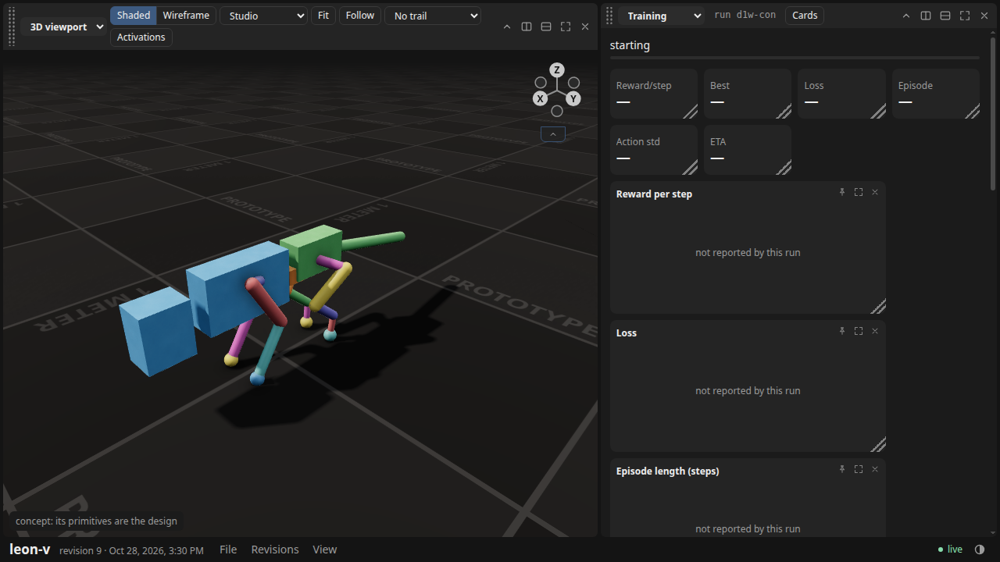
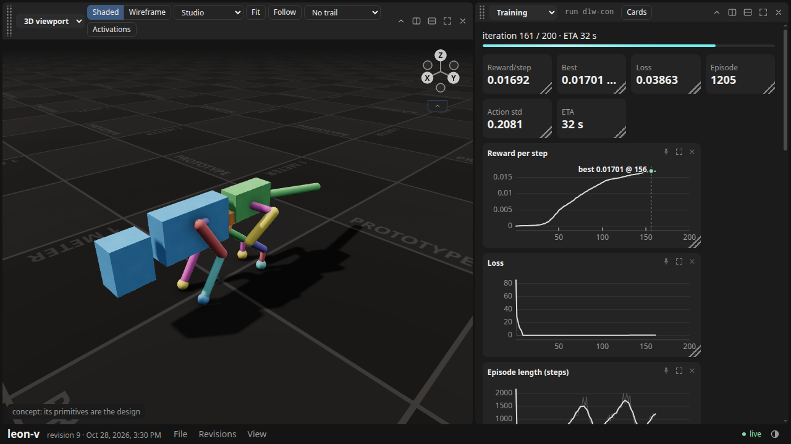
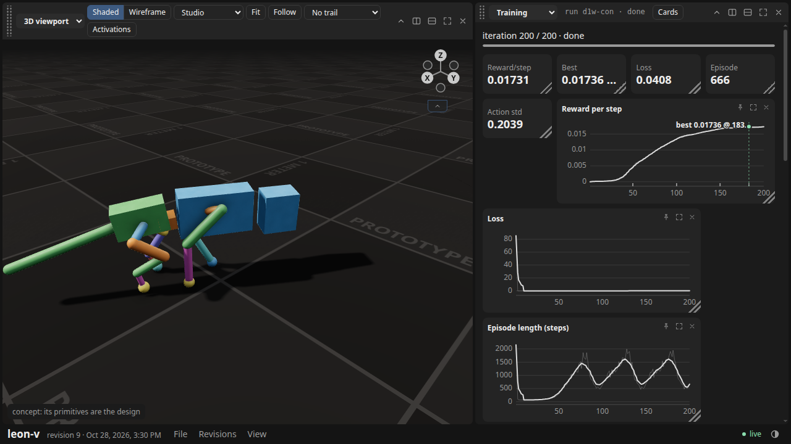
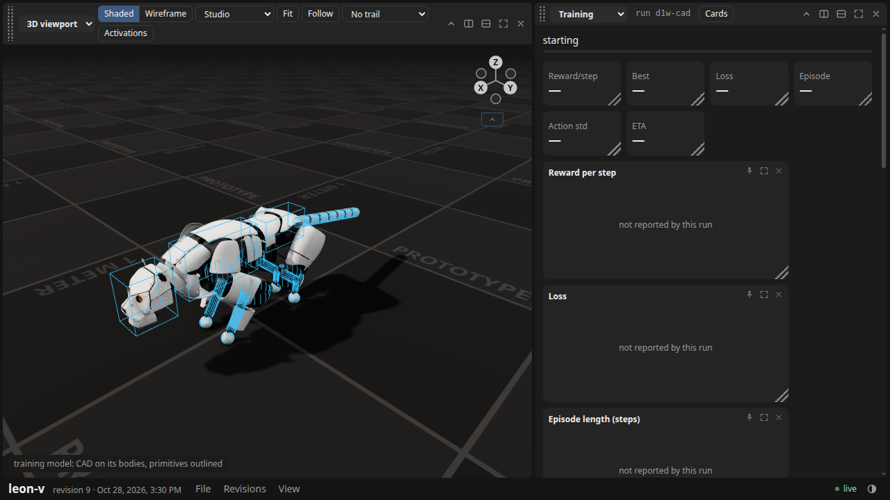
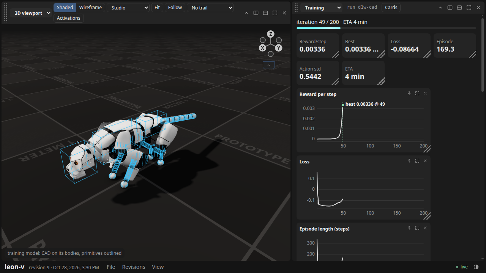
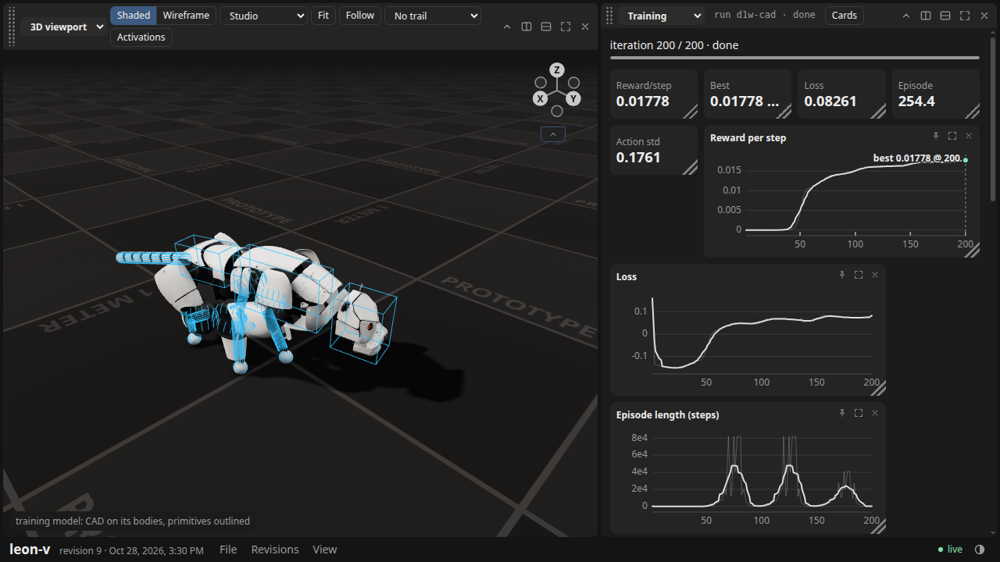
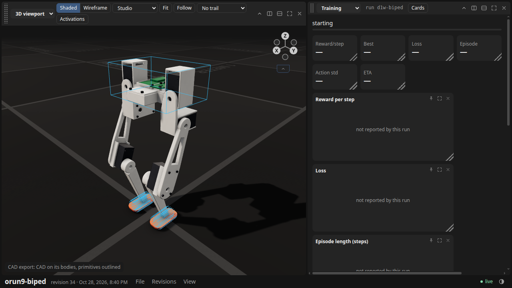
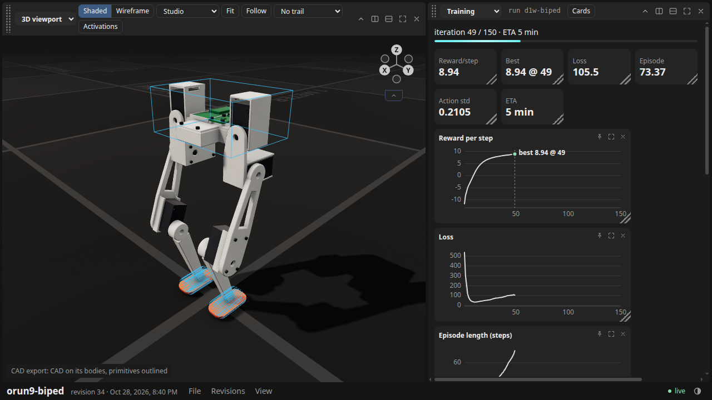
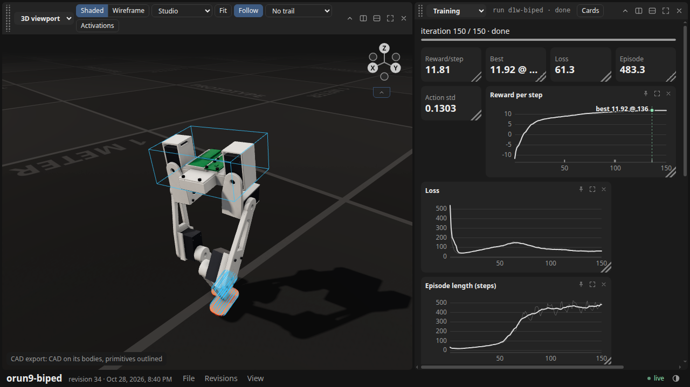

# D1: three bare shell runs, watched from launch to end

Verified against source: 2026-10-28 (`23d6bdf1` plus this page's probe scripts).

D1's proof: three `cadex_train.py` runs started from a shell, with no driver
writing anything for the dashboard, each watched in the dashboard at launch,
mid-run and end. The trainer's own run contract (ADR-837) and the CAD-on-bodies
overlay (ADR-838) are all the page reads.

**How.** `d1_watch.sh PROJECT RUN NAME TASK [trainer args]` starts the trainer
under `systemd-run --user --scope -p MemoryMax=30G`, waits for its first
`progress.json`, and shoots the page with `d1_shot.py` (the project served
read-only on 127.0.0.1, headless Chromium, 1280×720, run picked by name):
at launch while the model still compiles, at `MID_PCT` per cent of its
iterations, and after the trainer exits, with the closing rollout at 3 s and
the follow camera on. Each shot's page status is kept beside the run as
`d1-NAME-*.json`. All three trainers exited on their own (rc 0); none left running.

| Run (lab copy) | Tier, as the page labels it | Model | Trainer args | Wall | Best reward/step |
|---|---|---|---|---|---|
| leon V `runs/d1w-con` | `concept: its primitives are the design` (21 components, 0 outlined) | `cadex_concept.py concept/leon-v-d1.json`, bundled by leon V's `t1_bundle.py` (`671f38af…`) | 4096 envs × 200 it | 144.5 s | 0.01736 @ 182 |
| leon V `runs/d1w-cad` | `training model: CAD on its bodies, primitives outlined` (24 bodies, 16 outlined, 101 accepted parts) | `runs/t0/train-model.xml` (`df2e741f…`), `--cad-model` the accepted export (`41a4e7e0…`) | 4096 envs × 200 it | 191.9 s | 0.01778 @ 199 |
| orun9-biped `runs/d1w-biped` | `CAD export: CAD on its bodies, primitives outlined` (55 components, 3 outlined) | the accepted export itself (`2b9c8268…`), `--tier cad` | 8192 envs × 150 it | 373.2 s | 11.92 @ 135 |

Every run's `progress.json` says `run.driver: shell`, its tier and model digest,
its checkpoints (7, 7, 5) and `ended_at`; its `view/` holds the closing rollout
(301 frames, 6 s), which the end shots play.

**The biped first.** Its stored digest no longer reproduced (`sharp-chart-2136`), so
the lab copy was re-accepted with `cadex script --set` (47 s, same revision
`605e9bc8`, new attempt `1793234378369-90c8bf32f897`, verdicts pass). Its MJCF
export is byte-identical to the old attempt's (`2b9c8268…`), so the task bundle
is unchanged.

## The shots

| | Launch (compiling) | Mid-run | End (rollout at 3 s) |
|---|---|---|---|
| leon V concept |  `starting` |  161/200, ETA 32 s |  200/200 done |
| leon V training model |  `starting` |  49/200, ETA 4 min |  200/200 done |
| biped (CAD export) |  `starting` |  49/150, ETA 5 min |  150/150 done |

At launch every run already shows its model at rest (ADR-835) and its tier,
with the charts empty; mid-run the charts and the ETA are live; at the end the
closing rollout plays on the same bodies.

## Found while watching (for D2)

- **The episode-length chart reads 81,920 when no episode ends.**
  `cadex_train.py:4373` divides `unroll × envs` by `max(endings, 1)`, and a
  time-out is not an ending, so an iteration where every env survives charts
  `20 × 4096`. Leon V's CAD-derived run peaks at 8e4 on a 1,000-step episode.
  The run summary at `cadex_train.py:2923` clips to the horizon; the chart does not.
- **A page loading a large CAD overlay is slow to draw a run.** A shot of
  leon V's CAD run took 37 s from start to capture (101 parts), the concept's
  17 s. The mid shot had to start at 15% of its iterations to land mid-run;
  a first attempt triggered at 50% captured 149/150 (that attempt's run was
  discarded and re-run).
- **`fit()` frames the rest pose.** A design that walks off its rest bounds
  leaves the viewport empty at a later playback time unless Follow is on; the
  end shots turn Follow on.
