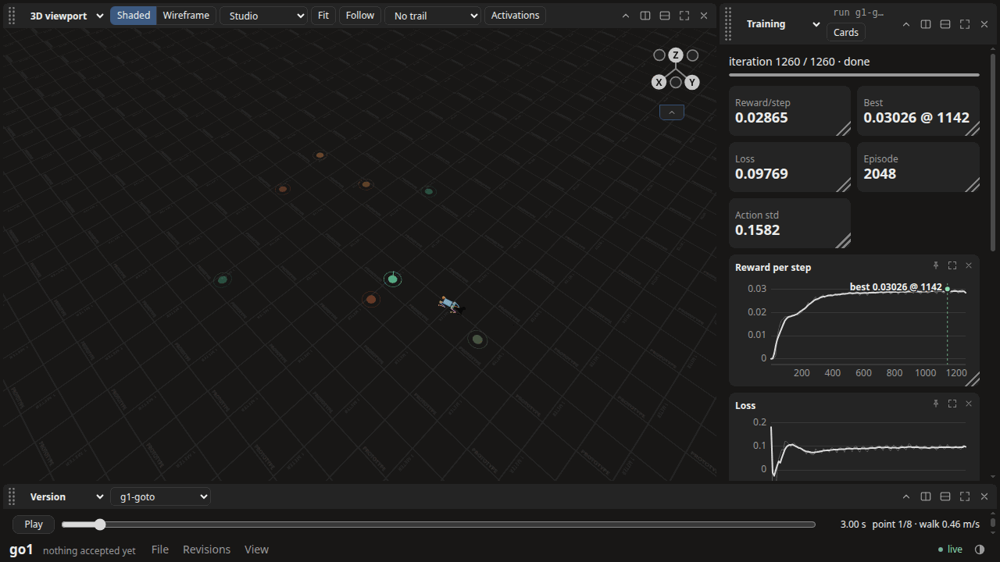
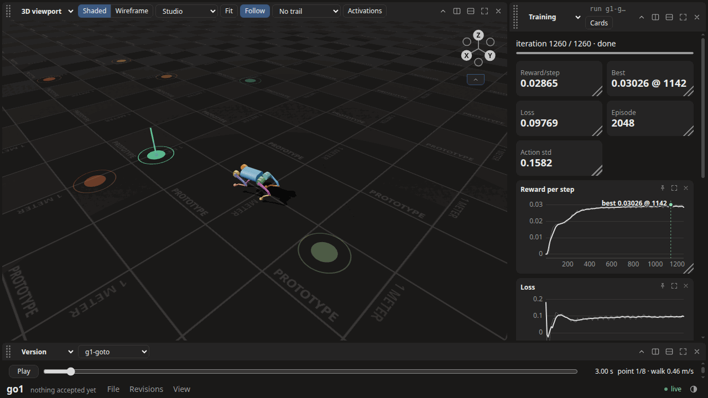
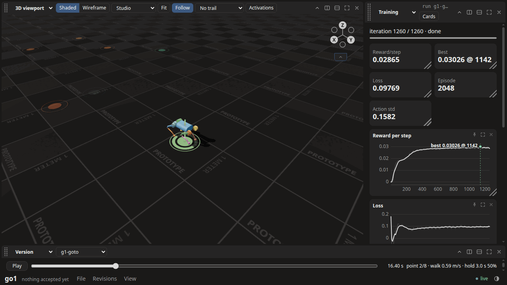
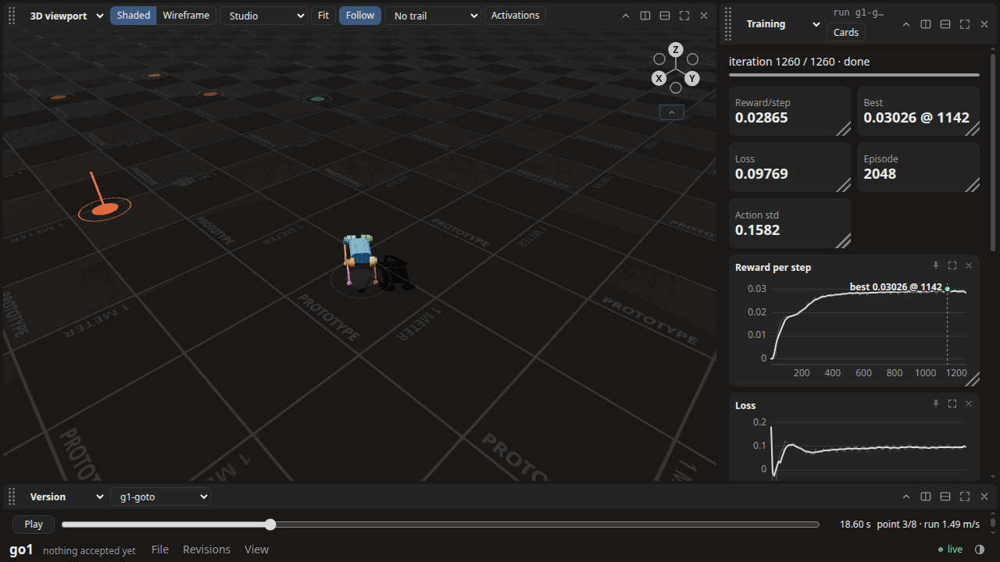
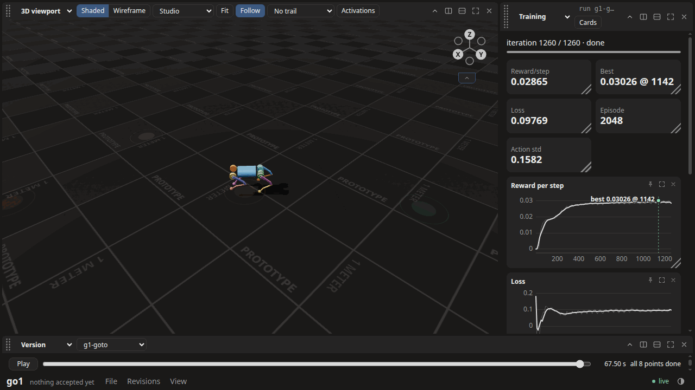
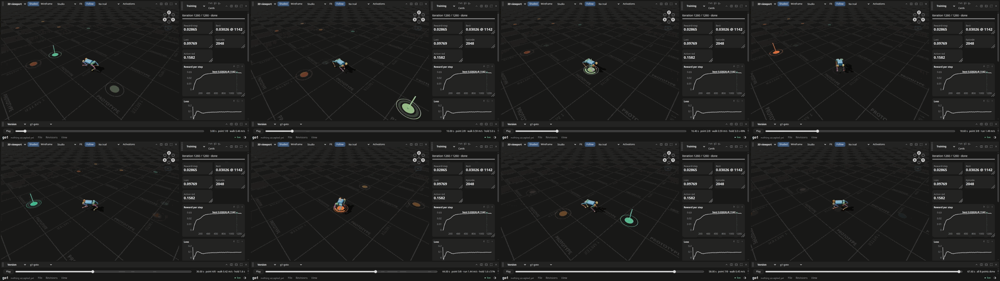

# G1: a go-to-point target the owner can see

Verified against source: 2026-10-28 (this commit). Frozen run evidence; read it, never cite
it as current.

The first half of G1 and the first piece of G2 (ADR-839). There is one seeded
point-sequence generator and the scripted layer of route A, both in
`training/cadex_goto.py`. The orun21 reference Go1 policy is driven through
them with no new training, and the dashboard draws the episode's targets
during playback.

## How

- **Policy.** `~/cadex-projects/orun21-lab/go1/run1/go1.cxpolicy`
  (`9ec81e8a…`, the reference of `GO1-BASELINE.md`: 206.4 M steps, its
  joystick commands vx ±1.5, vy ±0.8 m/s, yaw ±1.2 rad/s), copied with its
  `progress.json` to `go1/runs/g1-goto/seed0/`. That makes the lab's `go1/`
  directory a project the dashboard serves.
- **Episode.** Run from `go1/`:

      ~/cadex-train-venv/bin/python training/cadex_goto.py play runs/g1-goto/seed0/go1.cxpolicy \
          --task outputs/go1_joystick-task.json --seed 0 --split heldout \
          --bands walk:0.4-0.7,run:1.0-1.5

  This writes `view/` (Go1 primitives and a 25 fps trace with each frame's
  lit point and hold) and `goto.json` beside the policy. It takes under a
  second of CPU for 68 s of episode.
- **Shots and film.** `g1_shot.py` serves the lab's `go1/` on 127.0.0.1
  only and picks `run:g1-goto` in headless Chromium:

      pixi run python docs/probes/orun21/g1_shot.py ~/cadex-projects/orun21-lab/go1 g1-goto OUT --at 3 16.4 18.6 67.5
      pixi run python docs/probes/orun21/g1_shot.py ~/cadex-projects/orun21-lab/go1 g1-goto OUT --film

  The film seeks the playback every 0.2 s with the follow camera and encodes
  10 fps, so it plays at twice real time. It is
  `~/cadex-projects/orun21-lab/go1/films/g1-heldout0.mp4` and is not
  committed. `g1-film-strip.png` is eight of its frames.

## The sequence (`heldout:0`)

| # | bearing | band | speed m/s | hold s | arrived at s | closest m | worst in hold m | straight-leg speed / command |
|---|---|---|---|---|---|---|---|---|
| 1 | side | walk | 0.46 | — | — | 0.255 | — | 0.937 |
| 2 | behind | walk | 0.59 | 2.96 | 14.94 | 0.018 | 0.098 | 0.944 |
| 3 | behind | run | 1.49 | — | — | 0.250 | — | (no straight stretch) |
| 4 | ahead | walk | 0.42 | 1.62 | 36.24 | 0.027 | 0.099 | 0.926 |
| 5 | side | run | 1.44 | 1.58 | 43.22 | 0.018 | 0.100 | (no straight stretch) |
| 6 | ahead | run | 1.15 | 1.27 | 48.20 | 0.034 | 0.098 | (no straight stretch) |
| 7 | side | walk | 0.45 | — | — | 0.253 | — | 0.929 |
| 8 | behind | run | 1.27 | 1.61 | 65.80 | 0.029 | 0.097 | (no straight stretch) |

A point with no hold is passed on arrival within 0.25 m, so its closest is
about 0.25. A point with a hold starts the hold within 0.1 m. "No straight
stretch" means the leg never had a second at the full commanded speed while
facing the point within 10°. Those legs are run legs, short against their
slow-down.

## All ten held-out sequences, same policy

`go1/runs/g1-heldout/s<seed>/goto.json`, seeds 0–9, with 3–5 points behind
in each sequence:

| seed | seconds | reached | closest ≤ | worst hold | speed ratio | pass |
|---|---|---|---|---|---|---|
| 0 | 68.4 | 8/8 | 0.255 | 0.100 | 0.926–0.944 | all |
| 1 | 49.1 | 8/8 | 0.254 | 0.100 | 0.936–0.957 | all |
| 2 | 81.1 | 8/8 | 0.254 | 0.100 | 0.920–0.951 | all |
| 3 | 66.2 | 8/8 | 0.252 | 0.098 | 0.936–0.956 | all |
| 4 | 80.4 | 8/8 | 0.255 | 0.098 | 0.926–0.956 | all |
| 5 | 63.3 | 8/8 | 0.255 | 0.097 | 0.937–0.958 | all |
| 6 | 72.8 | 8/8 | 0.255 | 0.099 | 0.931–0.952 | all |
| 7 | 56.4 | 8/8 | 0.252 | 0.099 | 0.943–0.955 | all |
| 8 | 69.3 | 8/8 | 0.253 | 0.098 | 0.933–0.957 | all |
| 9 | 51.5 | 8/8 | 0.254 | 0.100 | 0.934–0.958 | all |

Over the 80 legs, all 43 walk legs had a straight stretch to read (0.920–0.953
of the command). Only 17 of the 37 run legs did (0.946–0.958). The other 20
are 2–5 m legs that the slow-down (it starts `speed / approach_gain` metres
out) and the turn leave too short for a second at full speed. G2 needs longer
run legs or a shorter read window before its speed bar covers the run band.

The joystick policy already does route A's job on flat ground. This is not
G2. G2 trains with the generator in the loop (C-1, C-13, C-19), states its
budget against Playground's, and judges with this `play`.

## The shots (1280×720, served on 127.0.0.1)

| | |
|---|---|
|  **Course, t = 3 s.** All eight points from above, coloured by speed (green walk, orange run). Point 1 is lit with its beacon. The rest are dim. |  **Walking to point 1, t = 3 s.** `point 1/8 · walk 0.46 m/s` beside the clock. |
|  **Holding at point 2, t = 16.4 s.** The ring is half full: `hold 3.0 s 50%`. Point 1 behind it is faint (done). |  **Point 3 lights behind the robot, t = 18.6 s.** It turns in place towards the orange (run) point: `point 3/8 · run 1.49 m/s`. |
|  **End, t = 67.5 s.** `all 8 points done`. Every point is faint. |  **Film strip.** Eight frames of `g1-heldout0.mp4`. |

## What is left for G1

G1 also asks for the targets in a film. This page's film is the dashboard's
playback, captured. `cadex evaluate`'s studio film (`cli/cadex_cli/film.py`,
ADR-459/463) still draws only a point goal's ring, and needs an accepted
attempt that a bare training run does not have.
