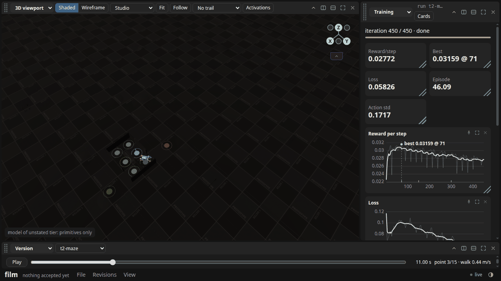
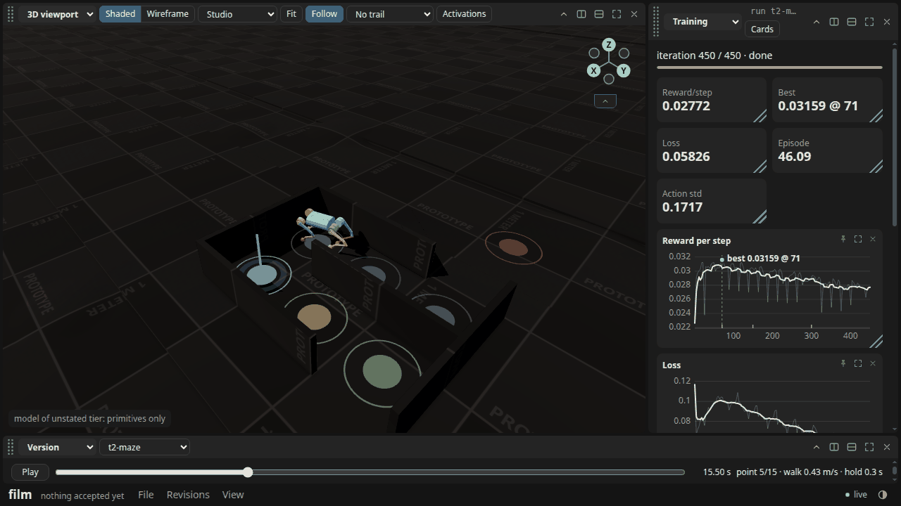
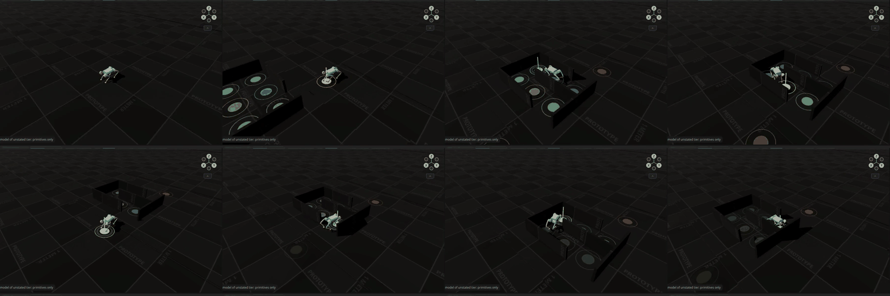

# T2: the Go1 scan policy steered through a maze

Verified against source: 2026-10-29 (this commit). Frozen run evidence; read it, never cite
it as current.

T2 asks that one held-out sequence pass a wall or maze section, with the points steering
the robot round. Until now no judge could place points through a corridor
(T2-SCAN.md). This is the first maze judgement (ADR-860).

## How

- **Courses.** `g2_judge.py --level L --maze` takes the bundle's terrain pool, turns its
  walls on (`wall_mm` 400–500 mm, which the Go1, about 0.3 m tall at the trunk, cannot step
  over; `maze_cells` 2–3), and draws each seed from the engine's held-out stream
  (`CadexDynamics.terrain_evaluation_course`). It keeps the first ten seeds whose course
  holds a maze. A maze's walls are `CadexDynamics.terrain_maze_walls`, matched to the
  course's box slots. Seeds 1, 4, 6, 10, 11 and 13 drew no maze and were skipped. The
  played seeds are 0, 2, 3, 5, 7, 8, 9, 12, 14 and 15, the same at every level.
- **Points.** `cadex_goto.maze_route`. From the origin to a lead point two cells outside the
  nearer door. Then each cell's centre on the shortest way to the far door, at walk speed.
  Then a held lead point outside, and the same way back to the first lead point, held. A
  cell where the way turns holds 0.3 s, so the layer arrives within 0.1 m and the turn
  happens at the cell's centre. The sequences have 7 to 15 points, 0 to 8 corners, and 1
  or 2 points behind the robot.
- **Walls against the body.** The Go1's terrain geoms collide only with its feet, so a wall
  would stop a foot but not a hip or a thigh. `play` reads every robot geom against every
  wall slot at each control step (`mj_geomDistance` < 0). Any such step fails the new
  `clear_walls` part. Check: a route forced straight through seed 5's maze reads 579 steps
  with the fore hips, thighs and calves in the walls.
- **Policy.** `go1-scan/run2` iteration 300, the best terrain checkpoint (T2-SCAN.md). It
  never trained on walls: the pool's `wall_mm` is unset.

## Ten held-out maze seeds per level (`go1-scan/judge-maze/`)

| level | pass | reach | hold | speed | no fall | clear walls | speed ratios |
|---|---|---|---|---|---|---|---|
| 0 | **10** | 10 | 10 | 10 | 10 | 10 | 0.91–0.99 |
| 1 | **9** | 9 | 10 | 10 | 9 | 10 | 0.91–0.99 |
| 2 | **10** | 10 | 10 | 10 | 10 | 10 | 0.89–1.00 |

G2's thresholds are unchanged: reach 0.3 m, hold 0.15 m, speed within 15%, no fall, and now
no body in a wall. The worst hold on any seed is 0.100 m. Level 1's failure is seed 12. It
falls at 48 s, turning round at its held lead point, which is outside the maze and 150 mm
from a 43 mm step edge. That is the terrain's failure, not the maze's.

## A first run, and the defect it found

The first run of the route marked only the inner cells as corners. A door cell where the way
turned had no hold, so the layer passed it at 0.25 m and the robot turned short of the
centre. Its hind hips, thighs and calves swept the wall on 4 of 10 seeds at every level
(seeds 3, 5, 7 and 12, 12–65 steps each, every first hit at a door cell). The fix makes
the door cells corners: the way runs on through the doors to the lead points. A test in
`test_cadex_goto.py` holds this. Every number above is from after the fix.

## Shots and film

`g1_shot.py` on a lab project holding level 2 seed 3 (15 points, 8 corners):
`~/cadex-projects/orun21-lab/go1-scan/film/`. The film,
`shots/t2-maze.mp4`, is not committed.

|  **The course, t = 11 s.** The maze's walls and the 15 points from above; point 3 lit. |  **In the corridor, t = 15.5 s.** Point 5 of 15 lit, a corner holding 0.3 s; the Go1 between the walls. |
|---|---|

 **Film strip.** Eight frames of `t2-maze.mp4`, about every 2 s of
the film (every 4.3 s of the episode): the start, the walk to the door, the corridor, the
held lead point outside, and the way back.

## What it shows

- **The points steer the Go1 through the maze.** 29 of 30 seeds pass the full bar
  through levels 0–2, with no body in a wall. This is a policy that never saw a wall,
  steered only by the go-to-point layer through cell centres.
- **What makes it pass is the route, not the policy.** The policy is the same in both runs,
  and holding the robot to the cell centre at each turn took wall hits from 4/10 seeds to
  0/10.
- **What it does not show.** The walls never touch the trunk's scan rows in a way the
  policy must react to. The robot turns in place at the centres and walks straight
  between them. A maze whose corridor is narrower than the Go1's turning circle (the smallest
  cell played was 738 mm, so 678 mm between walls) is not tested.

T2's maze clause is met at levels 0–2. T2's level-4 points are still open (T2-SCAN.md).
